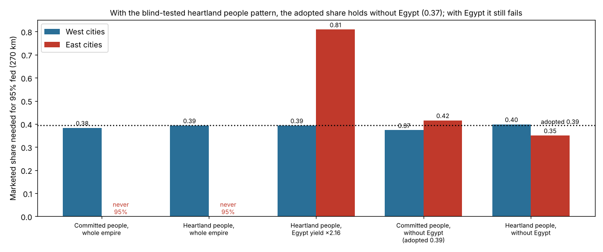

# Supply calibration with the heartland people pattern — 14 November 2026

Plan: `calibration/supply_heartland_people_20261114/plan.json`, committed before any output.

**Why.** The grain-supply calibration takes rural people from the committed Roman field, which puts every region at
0.32 of its farming capacity. The atlas also has a heartland-occupancy pattern, capacity × exp(−D/800 km) from the
old cores (Uruk, Memphis, Harappa, Zhengzhou, Rome), which was blind-tested on Domesday England as the best
population pattern (POPULATION_LEDGER_20261108.md). Here it replaces the committed pattern, rescaled to the same
window total (pattern tested, total supplied, as in the atlas).

| Variant (270 km) | e95 west | e95 east | Transfer W→E / E→W | Passes |
|---|---:|---:|---|---|
| Committed people, whole empire (= archive, exact) | 0.38 | never | 0.53 / 1.00 (at 540) | no |
| Heartland people, whole empire | 0.39 | never | 0.61 / 1.00 (at 540) | no |
| Heartland people + Egypt yield ×2.16 | 0.39 | 0.81 | 0.86 / 1.00 | no |
| Heartland people, without Egypt | 0.40 | 0.35 | 0.99 / 0.91 | **yes, e95 0.372** |

**Results.**
- **The adopted marketed share is robust to the people pattern.** Without Egypt the calibration passes again, at
  0.372 against the adopted 0.392 (5% apart; declared robustness band ×1.25). The cited 270 km haul limit is kept.
- **Egypt still fails.** The heartland pattern gives Egypt proper 2.55 M people (committed 0.71 M; historical
  4.5–5 M), and its cities are 52% fed at share 0.5 (committed 46%). With Egyptian yield ×2.16 they reach 66%, the east
  needs 0.81, and transfer is 86%. The upstream gap (output per km² on the Nile floodplain) remains the blocker,
  as in EGYPT_SUFFICIENCY_20261114.md.

**Implementation note.** The first run crashed on the without-Egypt variant: a network-cost cache, keyed only by
network, returned costs for the full city list. The first three variants had already printed, so they had been seen.
The cache was then keyed by city list, and a second attempt was killed for lack of memory, so it was bounded to one
city list. The results printed before the fix are identical to the final ones. Neither the plan nor any rule changed.

**Checks.** The control reproduces the archived surface exactly. The review reapplies the reviewed decision
reconstruction (68 checks), plus the robustness ratio and the equal window totals. A fresh run is byte-identical.

**Nothing adopted.** The fantasy map keeps share 0.3923. Switching the supply people field to the heartland pattern
is an owner decision; it would not change the share materially.
