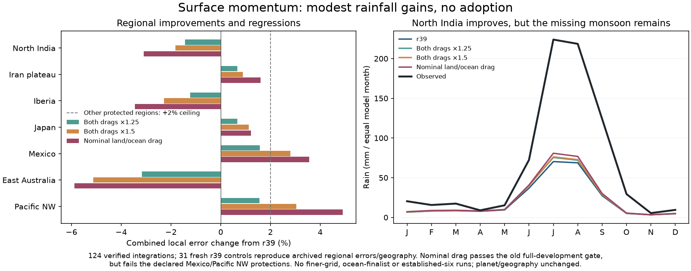

# Surface momentum: modest rainfall gain, rejected regional tradeoffs

Three fixed surface Rayleigh drag pairs, declared after the completed shear
pilot and before new results, change the momentum balance shared by surface
heat and moisture transport. Planetary forcing, actual geography and every
other r39 physical/numerical setting stay fixed. The column-shear ratio is1.
These are reused development data, not an independent new validation set.

All124 integrations pass observed numerical criteria. The fresh31-region
reference reproduces archived r39 temperature/rainfall errors within1e-10
and exact derived geography hashes before candidate interpretation.

| Candidate | Combined S | Temperature ratio | Rain-loss ratio | North India annual rain |
|---|---:|---:|---:|---:|
| r39 | 1 | 1 | 1 | 256 mm |
| Both drags ×1.25 | .996755 | 1.001397 | .992113 | 271 mm |
| Both drags ×1.5 | .995267 | 1.002455 | .988080 | 273 mm |
| Nominal land1e-4/ocean3.5e-5 per second | .994948 | 1.005340 | .984555 | 285 mm |

The nominal candidate passes the existing policy_v2 gate: combined improvement
above0.5%, no group worse, neither component worse by more than1%. All group
scores improve. Mean temperature MAE increases from1.792823 to1.802397°C,
while rain loss falls from.442366 to.435534 (1.54% better). North India's
rain loss improves6.81%, although its annual total remains far below761 mm
observed. These are actual integrated results, not a linear prediction.

**None qualifies under the complete new plan.** Both-drag×1.25 fails the
overall improvement and North India criteria; ×1.5 also fails Mexico and
Pacific NW protections. The nominal candidate fails those two regional
combined-error limits: Mexico1.036, Pacific NW1.049 versus the declared1.02.
No criterion is relaxed. No ocean-finalist, finer-grid or established-six
stage runs, and no r40 parameter profile is created. r39 remains adopted.

The old full31 gate alone can conceal a regional regression inside a group.
The added protections deliberately catch that tradeoff. A physically
interpretable setting and a favorable mean score are each insufficient for
adoption. The failure motivates separately probing the land and ocean drag
directions, rather than silently selecting or retuning on a held-out result.

`calibration/surface_momentum_20261026/plan.json` records the complete order,
criteria and budget. `output/surface_momentum_20261026/protocol.json` freezes
scientific/code inputs. All per-region records and failed review are retained.
The source version that produced them is committed with this report; future
tool revisions must use a new output folder. NPZ cell caches are optional
local research data with hashes in the records, not atlas dependencies.

The `.bat` hub's Climate accuracy page shows the result and portable JSON.
All three normal atlas climates, farming and population fields remain unchanged.

