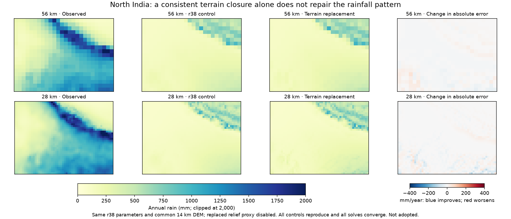
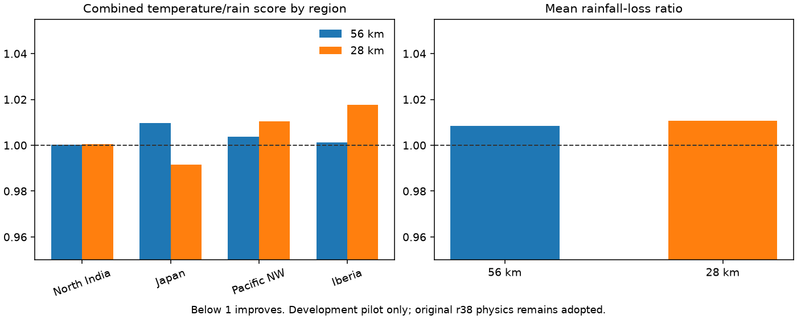

# Terrain geometry and moisture delivery: controlled r38 pilots

Two separate experiments keep Earth geometry and r38 parameters fixed, with
predeclared changes and strict numerical criteria. Neither qualifies for model
adoption; the `.bat` atlas climates remain on r38.

## Common fine-terrain uplift

The opt-in `terrain-quadrature` closure averages capped positive uplift over
area-weighted slopes from a common 14 km WorldClim DEM. It replaces the old
max-minus-mean relief term; enabling both is explicitly rejected. Mean fine
slopes supply the resolved lee term. Every cell retains its existing solved
vapor column; rain is an accounted sink, not an added map correction.

The fine reference frame is fixed across climate resolutions. A smooth plane
has no artificial growing roughness, and a common terrain footprint preserves
mean capped uplift under aggregation for uniform winds. Gaussian weather-wind
variations can also be averaged on each sample. This still assumes uniform
wind and vapor inside a climate cell; it does not resolve its internal airflow
or reconstruct sub-cell rain shadows.

All 16 paired runs (North India, Japan, Pacific NW, Iberia at 56/28 km) converge.
All four 56 km legacy controls reproduce cached r38 T/P arrays exactly at the
stored precision. The 98 focused tests include the coupled water residual and
flat-ground equality, source identities, capped uplift and area normalization.

| Resolution | Combined S | Temperature error ratio | Rain loss ratio |
|---|---:|---:|---:|
| 56 km | 1.002471 | 0.996493 | 1.008448 |
| 28 km | 1.004016 | 0.997414 | 1.010618 |

The closure alone makes mean rainfall loss worse and does not meet the plateau
error protection. It is available only as an experimental opt-in requiring
prepared terrain; the default remains legacy. This failure does not rule out
a separately declared retuning, but it provides no adoption claim.

## Faster transport of column water, tested separately

The existing `moisture_wind_factor` represents a faster aligned column flow
while preserving surface winds and temperature advection. The separate pilot
uses the legacy terrain closure, not the rejected replacement. It tests factors
1.25, 1.5 and 2 on the same four development regions. Verified r38 references
are reused with their original identities, exact source and parameter matches,
actual case hashes, package checks and cell-file hashes. No parent record is
rewritten as a new reference run.

| Column speed factor | Coarse S | Temperature ratio | Rain loss ratio | Qualifies |
|---|---:|---:|---:|---|
| 1.25 | 1.004270 | 0.997345 | 1.011195 | no |
| 1.5 | 1.010219 | 0.994856 | 1.025582 | no |
| 2 | 1.026898 | 0.990282 | 1.063515 | no |

None qualifies, so the predeclared 28 km finalist stage is not run. This says
that a uniform speed multiplier alone is insufficient under this pilot; it
does not establish the real vertical wind profile or the cause of the rainfall
error. Both experiments use reused development regions, not independent
validation. Complete plans, source identities, case records and decisions are
under `calibration/{terrain_quadrature,column_wind}_20261025/` and the matching
`output/` folders. Source fingerprints intentionally prevent reinterpretation
of these folders after later code changes.
