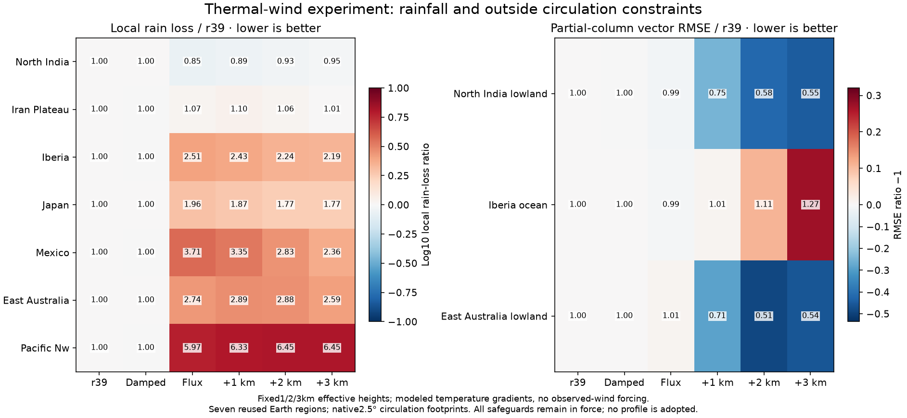
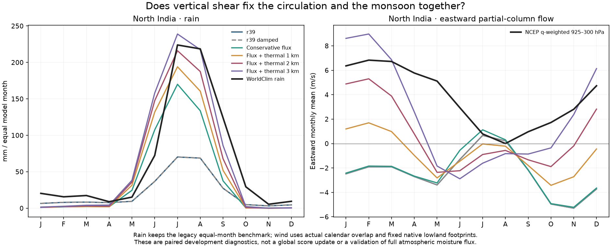
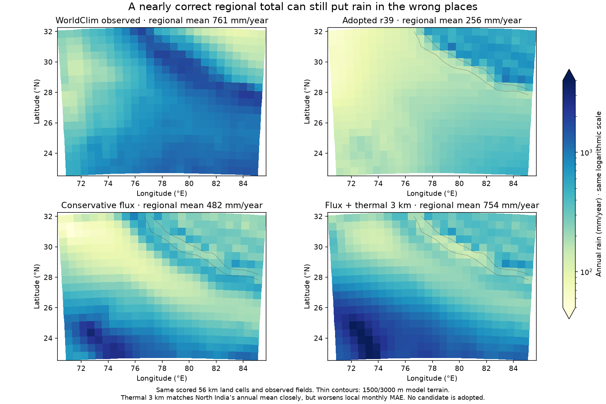

# Thermal-wind experiment: better mean flow is insufficient for local rainfall

The new thermal-wind closure substantially reduces North India and eastern
Australia partial-column wind errors while preserving an Earth-like planet.
It does **not** produce a qualifying climate fit. North India's3km trial nearly
matches observed regional annual rain,754 versus761mm/year, while its local
monthly rain MAE worsens from50.0 to59.3mm. Rain is too concentrated toward the
southwest and misses the observed Himalayan foothill band. Wet-coast errors
elsewhere remain large. This is why local, seasonal and outside-reference
safeguards cannot be replaced by matching a regional average.

The fixed six-profile/seven-region56km pilot completes42 integrations with
passing strict numerical certificates and conservative-transport ledgers where
applicable. Seven original r39 controls reproduce archived float32 climate
and observation arrays/geography exactly; three native circulation controls
also reproduce the separate outside audit exactly. No physical candidate
qualifies, so no full31/fine/established6 stage runs and no atlas climate is
replaced. Qualified Earth physics remains r39; the fantasy Earth atlas remains
r38 because its earlier r39 world-transfer checks failed.

## What changed physically

The opt-in `moisture_thermal_height_km` parameter defaults to zero. With an
effective moist-layer height H, hydrostatic/geostrophic balance gives an
approximate vertical wind increment:

```
du = -g H inverse_f d(log T)/dnorth
dv =  g H inverse_f d(log T)/deast
inverse_f = f / (f² + f10²)
```

T approximates a common-height layer-mean temperature: modeled sea-level-
equivalent temperature smoothed by a fixed500km Gaussian, minus half the
existing column lapse times H. This uniform-lapse approximation avoids treating
raw terrain-cooled surface temperature as a horizontal thermal front. f10 is
the Earth Coriolis magnitude at10degrees, providing a smooth equatorial taper.
It is not a resolved equatorial momentum balance. Retrograde spin changes the
sign consistently. H is fixed at1/2/3km in the three declared candidates.
The increment aloft does not receive empirical surface mountain slowdown.

Only the moisture wind and its associated divergence change. Surface momentum,
heat transport, evaporation, surface convergence lift and terrain ascent retain
the original surface flow. Mean and storm moisture transport use the already
implemented conservative closures, with legacy positive-convergence import
disabled to avoid double counting. Planetary radiation, rotation, radius,
orbit, tilt and real geography are unchanged. No observed wind is inserted
into a climate integration.

This remains an effective-layer approximation, not a prognostic atmospheric
momentum/energy model. It does not solve vertical mass return, transient
moisture covariance, a closed planetary water budget or the full vertical
temperature/humidity profile. It is a physically motivated experiment rather
than a claim to have solved those structural limitations.

## Paired results

| Profile | NI annual rain | NI local monthly MAE | NI rainfall loss | NI partial-column vector RMSE |
|---|---:|---:|---:|---:|
| Adopted r39 |256.26mm|50.010mm|0.941791|7.207m/s|
| Conservative flux, damped |481.71mm|48.790mm|0.802273|7.102m/s|
| Flux + thermal1km |578.58mm|52.818mm|0.837583|5.402m/s|
| Flux + thermal2km |665.92mm|56.422mm|0.873355|4.183m/s|
| Flux + thermal3km |754.35mm|59.254mm|0.897881|3.989m/s|

The reference annual total is760.83mm. Rainfall loss combines local annual
log error and normalized local monthly MAE; it is not an accuracy percentage.
The1/2km trials reduce that loss relative to adopted r39, while every thermal
trial worsens it relative to the conservative-flux diagnostic. Monthly MAE
worsens even though the regional annual total improves. The3km trial fails
the separately declared5% NI rainfall-loss improvement requirement.

| Thermal height | Seven-region combined S | Mean rain-loss ratio | Mean T-MAE ratio | NI wind-RMSE ratio | Iberia ocean ratio | East Australia lowland ratio |
|---|---:|---:|---:|---:|---:|---:|
|1km|1.6901|2.3724|1.0079|0.7495|1.0099|0.7148|
|2km|1.6379|2.2654|1.0104|0.5804|1.1080|0.5137|
|3km|1.5798|2.1426|1.0169|0.5535|1.2704|0.5399|

Ratios compare adopted r39 on identical inputs; lower is better. These are
seven reused development regions, not the complete31-region benchmark.
S is the mean of aggregate temperature/rain ratios, not a fit accuracy.
The1km trial passes all three outside-wind protections but fails regional rain
and ocean protections. The2/3km trials additionally worsen Iberia ocean wind
RMSE beyond2% and aggregate temperature beyond1%. Pacific NW annual rain
remains around4,000mm versus897mm observed; Mexico stays much too wet.
All actual failures and per-region ratios are in the downloadable JSON.

The damped r39 control uses moisture relaxation.05 and cap1024 versus the
original numerical profile, at the same residual.01/linear/temperature
tolerances. Its mapped monthly rain changes by at most.0091mm. Numerical
controls and the known over-wet conservative-flux profile are ineligible for
selection. Earlier failed experiments stay preserved; this successful solve
does not reclassify their failed runs.

## Outside constraints and development implications

Native NCEP/NCAR1981–2010 circulation targets and masks retain the separate
[circulation audit](CIRCULATION_20261026.md) definitions: geographic vectors,
true-area2.5-degree footprints, actual-month overlap and conservative model-
terrain/coast exclusions. NI partial-column vector RMSE must improve at least5%;
Iberia ocean and eastern Australia lowland RMSE may worsen at most2%. The
humidity-weighted925–300hPa target uses products of monthly means, excludes
transient q'u' and omits water outside those pressure levels. Reanalysis is
model-assisted; it does not establish full-column moisture-flux accuracy.
The single model layer and pressure references represent different heights.

The thermal response is useful evidence: missing vertical shear explains part
of the circulation discrepancy, but repairing that part cannot repair rain
placement alone. The next structural work needs to address where moisture is
removed and how vertical/horizontal circulation returns air, while retaining
the outside wind and regional climate constraints. Do not adopt a stronger
global rain multiplier or tune the planet away from Earth to compensate.
This pilot adds no further candidates after its fixed outcomes.

## Reproduction and publication

Source epoch `25a4c21`; fixed plan
`calibration/thermal_wind_20261026/plan.json`. Run:

```
OPENBLAS_NUM_THREADS=1 OMP_NUM_THREADS=1 .venv/bin/python scripts/check_vapor_flux.py \
  --plan calibration/thermal_wind_20261026/plan.json \
  --out output/thermal_wind_20261026
```

Frozen sources/reference files, case identities, all42 records, optional
hash-bound local NPZs and full safeguard decisions are retained in that output
folder. Changed sources require a new output epoch. New unit/integration tests
cover analytic thermal-wind sign, height scaling, reversed spin, f-plane
nondivergence, equatorial regularity, exact disabled path, conservative coupled
budgets, and rejection of changed native wind areas despite better rainfall.
The current focused model/reference suite passes129 tests.

The launcher-linked accuracy page includes all three new plots and JSON.
No climate, farm, population or trade values in the three normal atlases change.
The portable checker verifies every manifest asset, research link and a fresh
extracted launcher with the standard library.






