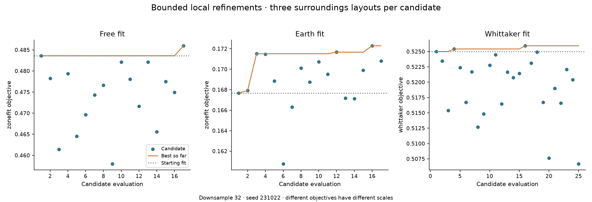
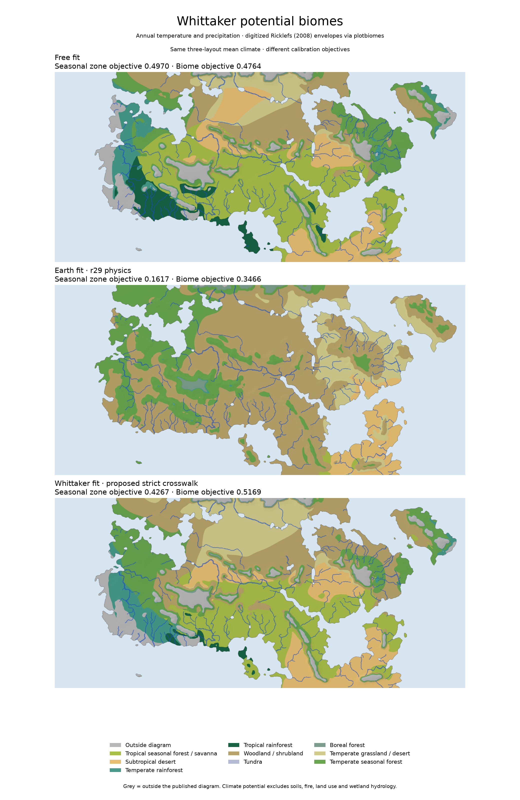

# Three-fit development campaign — 22 October 2026

This is the original three-fit publication snapshot. Later numerical and
Whittaker-coverage refinements are recorded in
[the iteration report](ITERATION_20261022.md). The tables and figures below
describe the original campaign rather than the subsequently refined atlas.

The user requested continued development and parallel updates of the free fit, Earth fit and a separate Whittaker-fit atlas. The campaign is complete: all three repository atlases are published, with the Harvest farming and settlement features integrated. Historical hosted claude.ai copies remain unchanged.

## Numerical development

Two numerical recovery options preserve the old default behavior and can be enabled explicitly:

- `solver_recover`: retry a capped over-relaxed linear solve using plain Gauss-Seidel; if necessary use the same sparse linear operator's direct solve and check its diagonal-scaled equation residual. The requested tolerance remains unchanged. Existing converged solves follow the original path.
- `t_anderson`: use bounded Anderson mixing in temperature/wind retry stages. The first stage remains the legacy iteration. Every retry still tests the full temperature update against 0.05°C, rather than shrinking the reported error by its damping factor.

Model results now carry observed numerical status for every linear solve and every temperature/moisture step, including seasonal spinup. Ensemble results retain each member's diagnostics. Atlas generation can require successful observed checks, and its default no longer silently disables the saved linear-convergence requirement.

The previously failing free-fit surroundings layout 2 at downsample 16 now completes in 132 seconds: 3,248 checked linear solves, 33 converged temperature steps, converged moisture throughout, three accelerated retry stages and one Gauss-Seidel recovery. Previously it failed at day 80.3 with a 0.499664°C temperature update after 1,344 iterations. This demonstrates numerical recovery, not independent physical validation.

Earth r29 was also checked on California, Chile and Western Europe at 56 km against the recorded earlier baseline. All observed checks pass; climate-distance changes are +0.00000282, −0.00000187 and −0.000000013 respectively. These are reused development regions, not new validation data. No physical constants were changed.

## Parallel calibration branches

Each branch uses one calibration worker; the three branches run concurrently on the two-CPU environment. Starting candidates remain eligible. Racing is disabled and numerical failures are rejected. All three now calibrate over layouts **1, 2 and 3**, rather than fitting the free and Whittaker branches only to layout 1.

| Branch | Starting parameters | Objective / fitted quantities | Budget | Local sigma |
|---|---|---|---:|---:|
| Free | Prior refined free fit | Seasonal zone-fit objective; world and existing e3b5 physics space | 17 incl. start | 0.005 |
| Earth | Prior r29 Earth fit | Seasonal zone-fit objective; world parameters only | 17 incl. start | 0.012 |
| Whittaker | Strict-crosswalk pilot winner | Strict Whittaker objective; world and e3b5 physics space | 25 incl. start | 0.012 |

Population size is 8 and seed is 231022. The search uses downsample 32 and 25 seasonal steps. The numerical profile uses rtol 1e-6, required linear/temperature/moisture convergence, recovery and accelerated retries. Earth physical constants are audited to stay fixed. These are bounded local refinements of the existing reversed-spin basin, not global optima or a new spin comparison.

All publication builds use **downsample 8, 25 seasonal steps, three-layout mean climate, and core layer images at twice source resolution**. Image exports share a lock to bound memory use. Publication classifies the mean climate fields; the optimizer averages scores from individual layouts. Those operations differ and the report retains both score definitions. Layouts 1–3 are training conditions reused for publication, not held-out validation; no claim of generalization to unseen surroundings follows from these scores.

The Whittaker atlas is a separate alternative interpretation. It retains the strict mapping already documented in [the crosswalk pilot](WHITTAKER_TARGETS_20261022.md). Annual-biome scores do not imply the original seasonal zones are matched. Its new **Biome targets** and **Biome match** layers make the actual hypothesis visible, with the crosswalk exported alongside the data. All three atlases expose both seasonal and biome diagnostics.

## Completed searches and publication

All 59 candidates completed without rejected numerical failures. These are small,
bounded refinements of the existing reversed-spin basin, not global searches.

| Search | Candidates | Starting objective | Selected objective | Gain | Selected candidate |
|---|---:|---:|---:|---:|---:|
| Free | 17 | 0.483600 | 0.485964 | 0.002365 | 17 |
| Earth | 17 | 0.167664 | 0.172285 | 0.004620 | 16 |
| Whittaker | 25 | 0.524992 | 0.525932 | 0.000940 | 16 |

The objectives have different meanings and scales. Calibration averages scores
from three individual layouts at downsample 32. Publication instead classifies
mean climate fields at downsample 8. The final atlas measurements are:

| Atlas | Seasonal objective | Exact seasonal zones | Strict biome objective | Mean exact biome match | Med. dry | Med. Cs |
|---|---:|---:|---:|---:|---:|---:|
| Free | 0.497045 | 54.36% | 0.476433 | 27.97% | 10.45% | 78.52% |
| Earth | 0.161677 | 20.29% | 0.346607 | 13.89% | 16.40% | 22.61% |
| Whittaker | 0.426672 | 52.21% | 0.516885 | 35.35% | 10.49% | 82.20% |

Mean exact biome match weights the seven target zones equally. Mediterranean
shares diagnose the original painted band independently of annual biomes.
The Whittaker fit trades original seasonal targets for the proposed annual
crosswalk; annual temperature and rainfall do not establish summer drought or
swamp hydrology. The original single-layout free atlas and these three-layout
means are different experiments; their final scores are not a controlled
before/after comparison. These layouts were used during calibration and are
not unseen validation data. No new claim of physical accuracy follows from
numerical convergence or the coarse search gains.





## Observed numerical checks and review

Each main map contains three independent surroundings layouts. Every layout
records positive solve counts and successful linear, temperature and moisture
checks, including spinup. Temperature checks use the full update below 0.05°C;
linear rtol remains 1e-6. The separate neighbourhood animations also pass.

| Atlas | Checked linear solves | Temperature steps | Accelerated retry stages | GS recovery solves | Direct recovery solves |
|---|---:|---:|---:|---:|---:|
| Free | 10,952 | 99 | 8 | 1 | 0 |
| Earth | 6,164 | 99 | 0 | 0 | 0 |
| Whittaker | 12,187 | 99 | 18 | 12 | 0 |

The original 80 focused numerical, Earth, calibration, seasonal and biome tests
passed during development. Seven additional Harvest tests cover thermal limits,
fixed normalization, moisture, food budgets, crop-pair labels, binary encoding,
seasonal lapse/phase and coastal aggregation. The five climate-comparison
JavaScript checks also pass. Final export verification checks every binary span,
biome mask/share, seasonal metadata, layer image, CSV and every GIF frame.
The ocean-only day/night-range empty-slice warning remains an export diagnostic,
not a capped or unconverged linear solve.

Chromium checks all three published pages on desktop and mobile, with grouped
layer controls, biome targets, named-place search, monthly maps, population and
disease scenarios, province sorting/highlights and shareable links. A fresh
Git checkout and Windows-style binary conversion are checked separately.
Read the saved validation JSON for the exact results.

## Atlases and reproduction

Open the [comparison hub](../atlases/index.html) through HTTP:

```sh
python3 scripts/serve_atlases.py
```

Or double-click `start_atlases.bat` on Windows / `start_atlases.command` on macOS.
Only Python's standard library is needed to serve the committed data. All three
complete data folders are in Git; opening HTML through `file://` is insufficient.
The portable ZIP includes the same atlases, launchers, reports and source notes,
with an integrity manifest. Packed climate and Harvest binaries are marked
binary for byte-exact Windows checkouts.

Each atlas has 152 named-place climate exports, five 25-frame animations, native
climate downsample 8 and 25 seasonal steps. Core map images are 4,000 × 1,852;
Harvest products use a 1,000 × 463 analysis grid and 2,000 × 926 display maps.
The free and Earth fits have 35 layers; Whittaker has 37, including its explicit
biome-target and biome-match maps. The grouped controls show at most seven
related layer buttons at once.

Food, malaria, settlement potential and expected density are derived separately
from **each atlas's own** exported solstice-aligned climate bins, DTR and seasonal
lapse rates. See [the Harvest method](HARVEST_MIGRATION_20261022.md) for the
published components, explicit scenario assumptions and population comparisons.

Selected parameters are in `calibration/three_fit_20261022/{free,earth,whittaker}`.
Immutable manifests and complete search reviews/evaluations are under
`output/three_fit_20261022/`. Each atlas carries simulation, export and Harvest
input fingerprints. The source audit confirms that simulation/scoring inputs
remained unchanged throughout the three searches and builds; Earth r29 physical
constants remain fixed. Previous active data are archived locally under
`output/three_fit_20261022/previous_atlases/` and preserved in Git history.

`scripts/three_fit_campaign.py` owns the bounded search and native build stages;
completed branches are marked promoted and exit without rerunning. Native local
checkpoints reject changed inputs. `add_harvest_to_atlas.py` regenerates only
the derived land products; `refresh_atlas_pages.py` updates page templates
without rerunning climate. `build_fit_hub.py`, the two comparison plot scripts
and `package_fit_atlases.py` rebuild the reviewed comparison/package artifacts.

The [earlier commit snapshot](../output/three_fit_20261022/commit_snapshot.json)
and [previous campaign report](CONTINUE_20261022.md) remain historical records.
