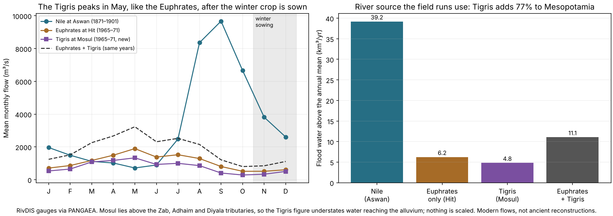

# The Tigris joins the flood inputs

**Outcome.** A Tigris gauge now qualifies on exactly the rules and years used
for the Euphrates. The Tigris at Mosul has six complete years (1965–67,
1969–71), the same six as the Euphrates at Hit, and peaks in May. On those years
it adds 4.8 km³/yr of flood water above its annual mean to the Euphrates' 6.2,
so Mesopotamia's river source rises by 77% to 11.1 km³/yr, against 39.2 km³/yr
for the Nile at Aswan. No field run uses it yet.

Protocol: [plan](../calibration/tigris_gauge_20261114/plan.json), committed in
`4e19dbee` before any Tigris discharge value was read.



## Results

| Gauge (RivDIS via PANGAEA) | Complete years | Mean flow m³/s | Annual km³ | Peak | Flood excess km³/yr | November 5-month compatibility |
|---|---|---:|---:|---|---:|---:|
| Euphrates at Hit (existing) | 1965–67, 1969–71 | 1,065 | 33.6 | May | 6.24 | 0.049 |
| **Tigris at Mosul (new)** | 1965–67, 1969–71 | 759 | 23.9 | May | **4.82** | **0.000** |
| Euphrates + Tigris, same years | 6 | 1,824 | 57.5 | May | 11.05 | 0.000 |
| Tigris at Baghdad | only 3 (1969–71) | – | – | – | – | unscored |

- **Timing.** The Tigris floods even more on the standing winter crop than the
  Euphrates: the November illustration gives it no pre-sowing advantage at all.
  Adding it makes Mesopotamia's timing worse, not better, for flood-recession
  farming of the Nile kind.
- **Volume.** More water reaches Mesopotamia than the Euphrates-only runs
  assumed, which matters for the planned test that the model does not inflate
  Mesopotamia.

## Limits

- Mosul is upstream of the Greater Zab, Lesser Zab, Adhaim and Diyala, which add
  a large share of the lower Tigris; the 4.8 km³ understates the water reaching
  the alluvium. Nothing is scaled.
- Baghdad, below those tributaries, has only three complete years and is also
  downstream of the 1956 Tharthar diversion; it fails the five-year rule.
- 1965–1971 flows are modern, not ancient reconstructions.

## Checks

- The existing 15 gauge-quality and phase controls pass before outputs.
- Independent review: regex HTML parse, 40-digit Decimal year means and excess
  volumes, scalar recomputation of all 252 phase values; the production parser,
  filter and primitive are not imported. Passes.
- A fresh run reproduces all five output files byte for byte.
- Existing seasonality outputs and producers are unchanged.

## Next

Declare a Euphrates-plus-Tigris river pool for Mesopotamia and a candidate-area
policy for Tigris land before any field score, keeping the Euphrates-only cases
as controls.

## Reproduce

```sh
.venv/bin/python -I scripts/tigris_gauge.py
.venv/bin/python -I scripts/tigris_gauge.py --out output/tigris_gauge_20261114/fresh
.venv/bin/python -I scripts/review_tigris_gauge.py
```
