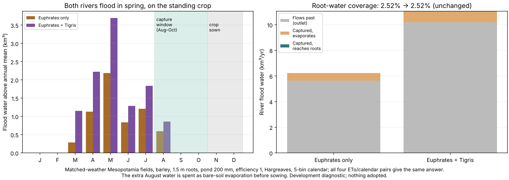

# The Tigris joins the flood inputs

**Outcome.** A Tigris gauge now qualifies on exactly the rules and years used
for the Euphrates. The Tigris at Mosul has six complete years (1965–67,
1969–71), the same six as the Euphrates at Hit, and peaks in May. On those years
it adds 4.8 km³/yr of flood water above its annual mean to the Euphrates' 6.2,
so Mesopotamia's river source rises by 77% to 11.1 km³/yr, against 39.2 km³/yr
for the Nile at Aswan. In the field run it changes nothing: both rivers flood in
spring, after the declared August–October capture window, so the extra water
flows past and Mesopotamia is not inflated.

Protocol: [plan](../calibration/tigris_gauge_20261114/plan.json), committed in
`4e19dbee` before any Tigris discharge value was read.


## Results

| Gauge (RivDIS via PANGAEA) | Complete years | Mean flow m³/s | Annual km³ | Peak | Flood excess km³/yr | November 5-month compatibility |
|---|---|---:|---:|---|---:|---:|
| Euphrates at Hit (existing) | 1965–67, 1969–71 | 1,065 | 33.6 | May | 6.24 | 0.049 |
| **Tigris at Mosul (new)** | 1965–67, 1969–71 | 759 | 23.9 | May | **4.82** | **0.000** |
| Euphrates + Tigris, same years | 6 | 1,824 | 57.5 | May | 11.05 | 0.000 |
| Tigris at Baghdad | only 3 (1969–71) | – | – | – | – | unscored |

- **Timing.** The Tigris floods even more on the standing winter crop than the
  Euphrates: the November illustration gives it no pre-sowing advantage at all.
  Adding it makes Mesopotamia's timing worse, not better, for flood-recession
  farming of the Nile kind.
- **Volume.** More water reaches Mesopotamia than the Euphrates-only runs
  assumed, which matters for the planned test that the model does not inflate
  Mesopotamia.

## Limits

- Mosul is upstream of the Greater Zab, Lesser Zab, Adhaim and Diyala, which add
  a large share of the lower Tigris; the 4.8 km³ understates the water reaching
  the alluvium. Nothing is scaled.
- Baghdad, below those tributaries, has only three complete years and is also
  downstream of the 1956 Tharthar diversion; it fails the five-year rule.
- 1965–1971 flows are modern, not ancient reconstructions.

## Checks

- The existing 15 gauge-quality and phase controls pass before outputs.
- Independent review: regex HTML parse, 40-digit Decimal year means and excess
  volumes, scalar recomputation of all 252 phase values; the production parser,
  filter and primitive are not imported. Passes.
- A fresh run reproduces all five output files byte for byte.
- Existing seasonality outputs and producers are unchanged.

## Field run: the Tigris in Mesopotamia's river pool

Declared in [field plan](../calibration/tigris_gauge_20261114/field_plan.json)
(`224fe579`) before any output. Matched-weather Mesopotamia fields, everything
as in the archived rows except the river source: 6.24 → 11.05 km³/yr.
The candidate fields did not need to change: the terrain rule already selects
land near any major river in the box, the Tigris included.



| Calendar · reference ET | Root water met, Euphrates only | With Tigris | Delivered km³, Euphrates only | With Tigris | Flows past km³ |
|---|---:|---:|---:|---:|---:|
| 5-bin · Hargreaves | 2.524% | 2.524% | 0.595 | 0.860 | 10.20 |
| 5-bin · Penman-Monteith | 0.674% | 0.674% | 0.595 | 0.860 | 10.20 |
| 4-bin fractional · Hargreaves | 2.604% | 2.604% | 0.595 | 0.860 | 10.20 |
| 4-bin fractional · Penman-Monteith | 0.728% | 0.728% | 0.595 | 0.860 | 10.20 |

- **Coverage does not change at all** (differences below 1e-17). Delivery rises
  by 0.265 km³, and all of it shows up as extra bare-soil evaporation in the
  weeks before November sowing.
- **Why:** under the declared capture rule fields take river water only in
  August–October, before sowing. Both rivers peak in March–July, so
  10.2 of the 11.1 km³ flows past.
- **For the planned non-inflation test:** adding the Tigris does not make the
  model inflate Mesopotamia. The reason is timing, which matches the historical
  contrast: Mesopotamian farming needed canals and winter–spring irrigation
  rather than Nile-style flood recession. A rule that lets fields draw spring
  floods would need to be declared and tested on both regions.
- The four rain-only cases reproduce the archived arrays exactly.

Independent review: the pooled source rebuilt from the raw gauge pages with
Decimal arithmetic and the previously reviewed scalar river/soil/pond reference
with matched forcing; 3,078,432 field-steps, eligibility, annual field stocks
and fluxes, monthly basin ledgers and daily stocks compared; largest annual field
difference 1.7e-12 mm. A fresh run reproduces both files byte for byte.

## Next

The Tigris no longer blocks the Mesopotamia side of the test. What decides the
answer is the capture season: declare a spring-capture (canal) sensitivity for
both regions before any harvest rule, with Mosul's understatement kept in view.

## Reproduce

```sh
.venv/bin/python -I scripts/tigris_gauge.py
.venv/bin/python -I scripts/tigris_fields.py && .venv/bin/python -I scripts/tigris_fields.py --out output/tigris_fields_20261114/fresh && .venv/bin/python -I scripts/review_tigris_fields.py
.venv/bin/python -I scripts/tigris_gauge.py --out output/tigris_gauge_20261114/fresh
.venv/bin/python -I scripts/review_tigris_gauge.py
```
