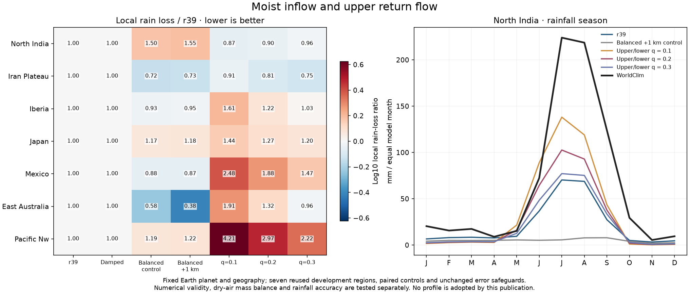
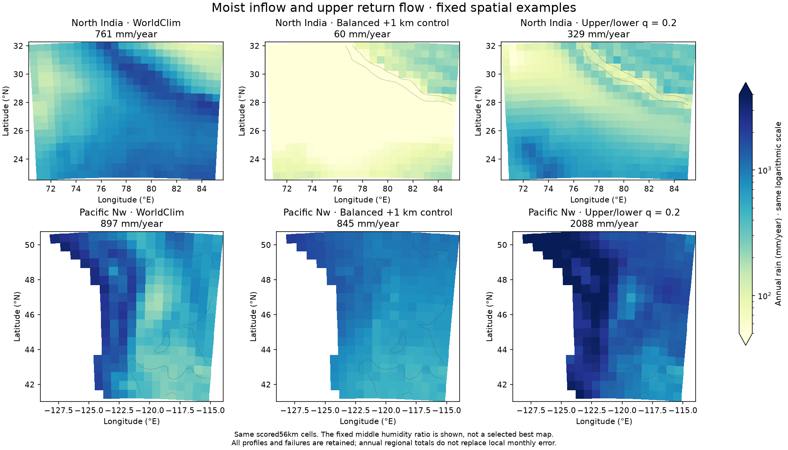

# Separate moist inflow and upper return: monsoon restored, coasts still too wet

The two-branch experiment restores much of the monsoon lost by the stationary
single-column closure. Its lowest upper/lower humidity ratio gives423mm/year
in North India versus60mm for the balanced1km control and761mm observed.
Local monthly MAE falls to46.97mm, compared with50.01mm for adopted r39.
But coastal and other regional errors remain too large. No candidate passes
all fixed safeguards and no climate fit or atlas climate is adopted.

All49 integrations pass strict numerical checks. The first28 controls reproduce
the original climate/geography, three native wind controls and every field in
21 archived physical/numerical NPZ controls exactly. Only then are21 new
candidate integrations run. Source `119d54d`; frozen plan
`calibration/two_layer_20261026/plan.json`; all records and hashes in
`output/two_layer_20261026/`. The current focused model/reference suite passes
154 tests. Earlier failed campaigns remain preserved.

## Physical construction and exact discrete transport

The lower dry-air mass fraction eta is fixed at.25. Given lower wind Ul and
the projected mass-consistent column wind Ub, the upper wind is
`Uupper=(Ub-eta*Ul)/(1-eta)`. Thus the combined dry-air flow is Ub exactly.
For layer-mean specific-humidity ratio r=q_upper/q_lower, the lower fraction
of total column water is `eta/[eta+(1-eta)r]`. The three fixed candidates use
r=.1/.2/.3, all with the already-tested1km lower thermal shear and unchanged
Earth planetary forcing/geography. No observed wind enters a climate solve.

Each branch is upwinded separately. The actual matrix coefficients, local
water residual and regional boundary ledger use the same sum of directional
face fluxes. An averaged velocity is retained for outside-wind comparisons,
but does not replace these donor fluxes in the solve. Opposed donor streams
can exchange water on a finite-volume grid even when their mean velocity is
zero. This includes grid-dependent first-order upwind mixing; it is not a
measured physical diffusivity and cannot bypass the finer-resolution gates.

Total W is still one prognostic column state implicitly redistributed to a
fixed vertical humidity profile. This is not a model with independent vertical
humidity/temperature, momentum, cloud or return-flow states. Surface heat,
evaporation, convergence lift and terrain ascent retain surface winds.
`moisture_two_layer=False` preserves the old path; the optional humidity
parameter is explicitly in the shared joint-physics block.

| Profile | NI annual rain mm | NI monthly rain MAE mm | NI rain loss | Seven-region S | Mean rain-loss ratio |
|---|---:|---:|---:|---:|---:|
| Adopted r39 |256.26|50.010|0.941791|1|1|
| Balanced1km control |59.72|59.855|1.457462|historical|historical|
| Two branches,r=.1 |423.26|46.968|0.816302|1.3659|1.7254|
| Two branches,r=.2 |329.36|46.199|0.846085|1.1821|1.3627|
| Two branches,r=.3 |265.30|47.579|0.908537|1.0759|1.1577|

Ratios compare adopted r39 on identical reused development regions; lower is
better. Rain loss combines local annual log error and normalized monthly MAE,
not an accuracy percentage. Even the middle ratio leaves Pacific Northwest
around2088mm/year versus897mm observed. It also worsens local Iberia, Japan,
Mexico and eastern Australia errors. The.3 trial still fails Japan/Mexico/
Pacific NW protections and does not reach the required NI improvement.
No full31/fine/established6 stage runs after the failed screen.

All separate-branch speed limits pass: maximum21.38m/s, largest per-step95th
percentile16.33m/s. Dry-air cancellation reaches at worst9.18e-15 versus the
fixed1e-10 limit. These numerical properties are independent of rainfall skill.
All non-original profiles retain.05 relaxation/1024 cap and the original
.01 moisture-residual, linear and temperature error tolerances.

## A manufactured consistency issue found during this round

A separate no-rain/no-source manufactured case starts with uniform water
mixing ratio over terrain rising0–4000m. The stationary dry-air flux uses face
mass M_face, while current vapor transport upwinds donor column water W.
With W proportional to M, that mismatch produces a spurious local transport
divergence of.07475mm/day on a9×11,56km grid. Total boundary-accounted water
still conserves; this is erroneous tracer redistribution, not free water.

An independent construction `M_face*U_face*(W/M)_donor` reduces that same
uniform-tracer residual to2.52e-14mm/day. It was not substituted into this
completed pilot. The diagnostic is in `tracer_diagnostic.json`, separate from
the declared climate selection. It motivates the next independently declared
source epoch: consistent mass-aware advection, mixing-ratio diffusion and
storm exchange using the same column mass. The default/old controls must still
reproduce exactly. Uniform-q equilibrium with no physical sources is an
operator consistency test, not a newly sampled climate-accuracy threshold.

The standard launcher accuracy page includes all seven profiles, two new
figures/maps, the NI table and JSON. Partial-column/reanalysis/period and
flat-grid limitations remain as in the preceding reports. The global/city
headline scores and normal climate/farm/population/trade data are unchanged.

