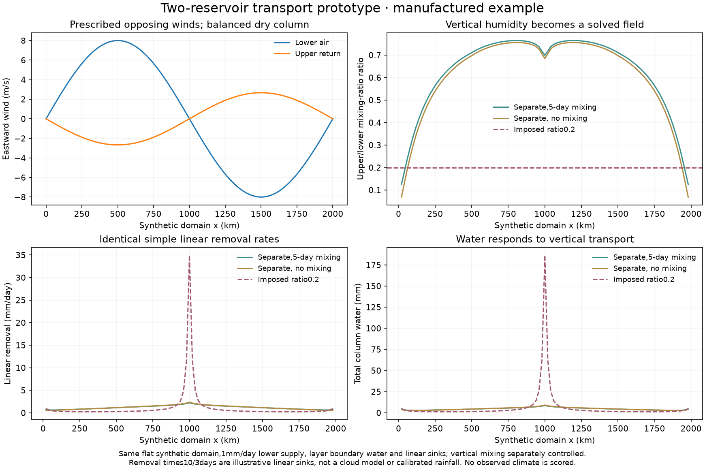

# Separate water reservoirs and vertical air continuity

The fixed-profile two-branch experiments conserve total water, but force an
upper/lower specific-humidity ratio rather than solving each layer's humidity.
Their measured coastal excess is primarily mean-flow import, partly offset by
storm export. The next structural question is whether a fixed dry return
exaggerates moisture accumulation where lower air converges.

`experiments/two_reservoir_transport.py` is an isolated research operator.
It is **not wired into ClimateModel**, and has no Earth accuracy or atlas
adoption claim. Both layer water amounts are independent unknowns. Dry-layer
masses remain prescribed and steady, while vertical air exchange is diagnosed
from continuity rather than independently solving vertical momentum.

With lower mass fraction eta and column mass M, the winds must satisfy

    div[eta M U_lower + (1-eta) M U_upper] = 0.
    F = -div(eta M U_lower)

Positive F carries lower donor mixing ratio upward; negative F carries upper
donor mixing ratio downward. The water exchange is

    F_water = max(F,0) q_lower + min(F,0) q_upper

and enters the lower and upper equations with equal and opposite signs.
Optional symmetric vertical conductance
`mixing_rate*M*eta*(1-eta)` exchanges the humidity difference. Horizontal fluxes
use the existing exact common-mass donor stencil; diffusion transports q.

Consequently, a uniform mixing ratio remains uniform **in each layer** over
varying terrain even when each layer has horizontal divergence. The vertical
flux balances that layer's dry-air divergence. Total water exchange cancels
between layers, and the open regional boundary supply remains explicit.
The sparse two-layer operator has nonpositive off-diagonal coefficients and
nonnegative loss terms. Each solved system is independently certified against
its actual matrix equation; inconsistent dry-column winds are rejected.

## Verification and controlled illustration

Nine new tests cover uniform-q equilibrium, three independent random
matrix/face/vertical-ledger comparisons, an analytic convergence case, positive
variable layer humidity with a closed water ledger, invalid mixing, and dry-mass
inconsistency. Together with existing layer, mass-tracer and storm-rainout
checks,46 focused tests pass. No climate integration is included in this count.

`python scripts/diagnose_two_reservoir.py` generates a flat synthetic domain
with opposing balanced winds,1mm/day lower-layer water supply and linear
removal times10days below/3days aloft. These are illustrative sinks, not cloud
physics or calibrated rainfall. All comparisons use identical winds, surface
supply, removal coefficients, and **both layer boundary values**. The fixed
ratio0.2 profile and the two independent reservoirs are compared; a separate
zero-mixing case distinguishes vertical advection from5-day turbulent mixing.

The imposed-ratio version develops a sharp water/removal peak at convergence.
Solving the upper water field allows the return flow to moisten and strongly
reduces that peak, including without explicit vertical mixing. This is evidence
about a manufactured mechanism, not evidence that Earth rainfall improves.
The local two-layer water ledger closes to about3e-14mm/day in the5-day example;
all diagnostics and plotted values are retained in the companion download.

## Remaining coupling requirements

A climate implementation still needs a physical distribution of saturation
capacity, condensation and evaporation between layers; finite cloud/rain
conversion, surface ocean humidity exchange, consistent storm transport, and
full water certificates with those terms. The present operator has no separate
vertical temperatures, saturation, cloud microphysics, latent heating, storms,
momentum or time tendency. It must not simply replace a calibrated equation
and inherit its scores. A sparse direct solve is adequate for this proof but
may be expensive inside the full seasonal nonlinear moisture iteration.

The next phase should first establish independent nonlinear column balances,
then replay controlled Earth seasonal inputs with explicit frozen-state
limitations before a coupled model benchmark. All original numerical, ocean,
regional rainfall, temperature, wind and matched-world gates remain required
before replacing any published climate. Planetary settings remain Earth-like.
