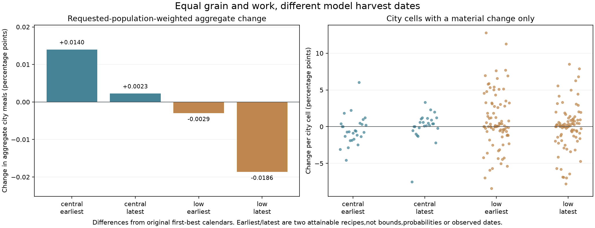
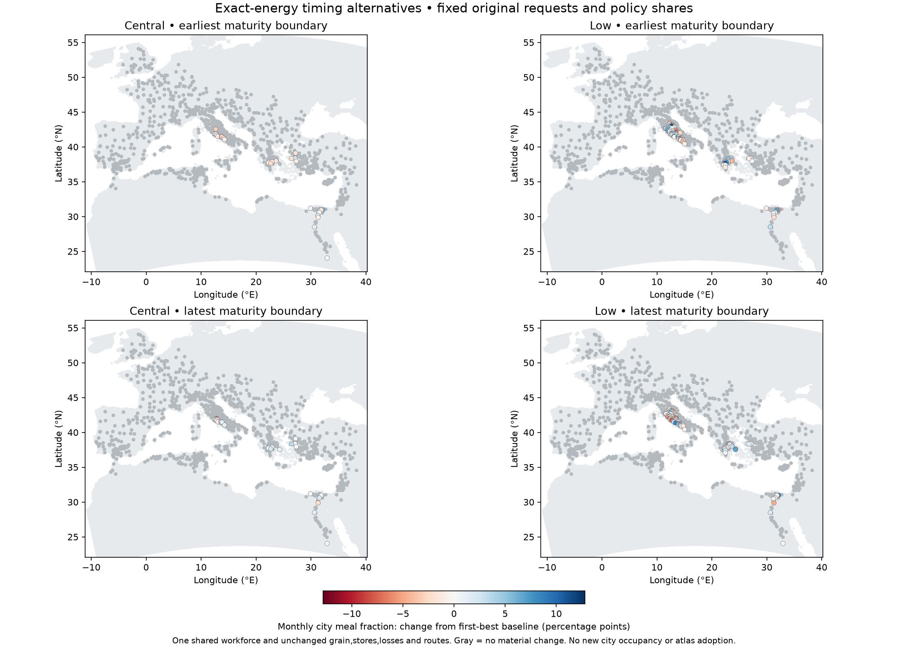
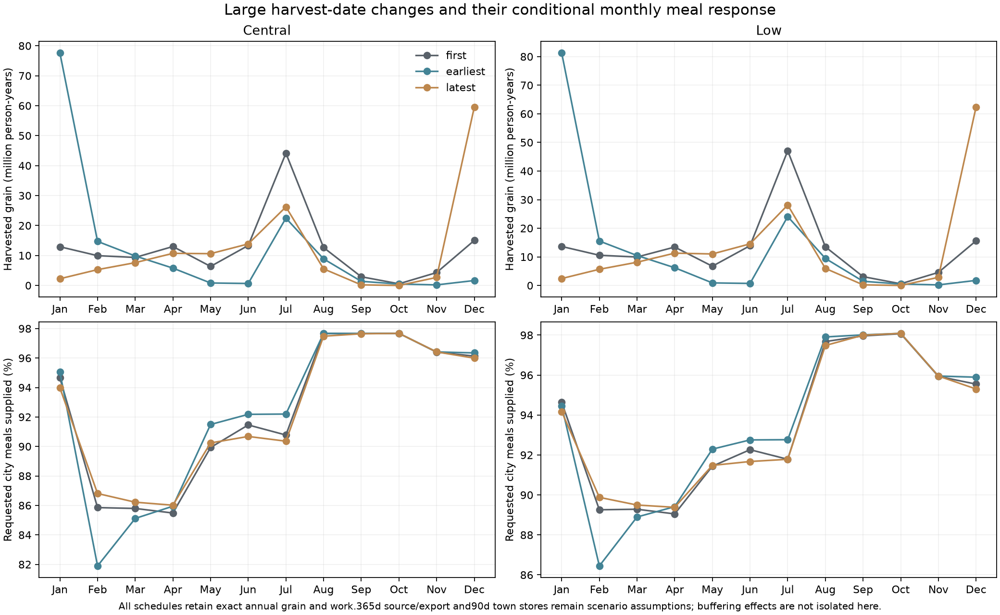

# Equal-energy dates: small aggregate changes, larger local effects

The four declared timing experiments are complete and independently reviewed.
They retain the original grain, work, population, calibrated shares, stores
and routes. Changing only the selected equal-energy crop windows moves aggregate
city meal coverage by at most **0.0186 percentage points**, but individual city
cells move by up to **12.78 points**. Neither aggregate stability nor these
two scenarios qualify a new settlement map or observed harvest dates.



| Density | Original first-best | Earliest eligible boundary | Latest eligible boundary |
|---|---:|---:|---:|
| Central | 92.4578% | 92.4718% | 92.4601% |
| Low | 93.5758% | 93.5729% | 93.5572% |

These are percentages of unchanged city meal requests. The original central
result is below both alternatives, while the original low result is above both.
Earliest/latest **do not bound network outcomes**; they are two predeclared,
individually attainable model-window assignments, not optimizations, probability
distributions or confidence limits. The original first-best recipe remains the
reference. No variant is adopted for feeding more people.

## How much calendar ambiguity exists

The original selected crop is barley on all positive source activities.
Exact enumeration reproduces its full-precision maximum and first season mask,
and the original float32 energy saves and float64 floodplain capacities, before
looking at alternative dates. There is no near-equality or quantization-based
expansion of the tie set.

Of 53,550 positive base/basin components, **35,156** have more than one eligible
harvest boundary. Those components account for **67.581% of annual grain
potential**. All 455 positive floodplain components have multiple eligible
boundaries, even after excluding growing windows that intersect saved
catchment high-flow bins. Zero-energy components retain their unavailable
status; no date is invented for them.

The two alternatives choose the earliest or latest calendar-year maturity
boundary per component. Remaining ties at that boundary retain the original
length/start enumeration order. Base and floodplain activities keep separate
physical subareas and share one workforce. B600h work is recalculated at every
alternative's dates, and original retained grain, annual work and population
arrays remain bit-exact. Monthly reaping budgets remain feasible.

These are ends of feasible windows in the legacy crop evaluator. Its heat and
water thresholds are not a complete physiological-development model; an equally
productive longer window is not evidence that real crops would wait until
its final bin to mature or be harvested. Modern calendars and the previously
tested conditional development clock are discussed in the next evidence audit,
not substituted into this experiment.

## Local differences matter

| Case | Meal-equivalent change, person-years | City cells gaining / losing | Largest absolute city change |
|---|---:|---:|---:|
| Central, earliest | +1,172 | 11 / 16 | 6.02 pp |
| Central, latest | +188 | 18 / 8 | 7.50 pp |
| Low, earliest | −119 | 49 / 36 | 12.78 pp |
| Low, latest | −755 | 51 / 37 | 8.53 pp |



Full-meal city counts also change: central has 1,046 in the original,
1,044 earliest and 1,048 latest; low has 967, 956 and 967 respectively.
These are food flags at fixed requests, not new occupancy, staff or political
source sets. Small aggregate changes can hide offsetting local gains and
losses. Nothing here establishes robustness across every possible assignment
of tied windows.



The trial retains 365-day rural/export stores, 90-day town stores, 5% annual
loss on stored grain, the same four actual 1981–2010 route snapshots and
one-bin freight delays. The graphs show the conditional response under that
bundle. They do not isolate storage buffering as a causal explanation, nor
calibrate those capacities or losses.

## Controls and review

Both original monthly cases reproduce **all 70 saved food arrays exactly**.
The original annual B allocation and all six older annual cases remain
unchanged. The new selected-window library passes six meaningful tests,
including one-ULP non-ties, first-window tie order, cyclic dates, flood filtering,
no eligible positive window and zero-yield calendars. The existing seven
monthly-adapter and twelve work-budget test identities remain unchanged.

The independent catalogue reviewer uses a separately written crop-window
calculation and original reference masks. It checks exact energies, all eligible
boundary sets, first windows at each boundary, source-pixel mappings and
contiguous growing masks. The four food reviews independently group reaping
work, replay every inventory with the canonical bisection kernel, and rebuild
monthly source arrivals and sorted inter-town shipment ledgers.

Across four cases, the review covers 225,512 physical source-cases, sixteen
inventory groups and **31,728 shipments**. All inventories pass their original
1e-10 relative tolerance; the largest discrepancy is 0.57741 of that allowance.
Grain ledgers close within 1.72e-8 person-years. Source and town food-eligibility
flags match the canonical replay. No tolerance was relaxed and no demographic
iteration was performed.

The [qualification receipt](../output/urban_calendar_sensitivity_20261116/qualification.json)
seals the catalogue, controls, four cases and presentation.
[All 4,340 city differences](../output/urban_calendar_sensitivity_20261116/towns.csv),
[summary](../output/urban_calendar_sensitivity_20261116/summary.csv),
[72 monthly rows](../output/urban_calendar_sensitivity_20261116/months.csv),
[regions](../output/urban_calendar_sensitivity_20261116/regions.csv) and
[component ambiguity](../output/urban_calendar_sensitivity_20261116/ambiguity.csv)
are retained. The compact catalogue and town packet are tracked; large stock
arrays remain reproducible ignored caches.

## Next declared step

The [evidence and buffer-usage audit](../calibration/urban_diagnosis_20261116/seasonal_transfer_evidence_buffer_audit.json)
checks what the already exposed modern calendars, conditional phenology
evaluation, FAO56 stage examples and reserve algebra actually support. It also
measures baseline stock use from existing paths without changing capacities
or rerunning food scenarios. It will distinguish unsupported historical
assumptions from verified accounting and select a bounded next experiment.

This does not reopen raw observation pools or treat the already scored cereal
evaluation as unseen evidence. Full work/diet, rights, all-rural meals and
independent transfer remain adoption gates. Main atlas/defaults, Buringh sizes
and climate calibration remain untouched.

## Reproduction

After verifying parent inputs, run into an empty isolated output:

```sh
.venv/bin/python -m pytest -q tests/test_exact_crop_windows.py
.venv/bin/python scripts/urban_calendar_sensitivity.py --catalogue
.venv/bin/python scripts/review_urban_calendar_catalogue.py
.venv/bin/python scripts/urban_calendar_sensitivity.py --reading central
.venv/bin/python scripts/urban_calendar_sensitivity.py --reading low
.venv/bin/python scripts/review_urban_calendar_food.py central earliest
.venv/bin/python scripts/review_urban_calendar_food.py central latest
.venv/bin/python scripts/review_urban_calendar_food.py low earliest
.venv/bin/python scripts/review_urban_calendar_food.py low latest
.venv/bin/python scripts/render_urban_calendar_sensitivity.py
.venv/bin/python scripts/seal_urban_calendar_sensitivity.py
```

Completed catalogue/cases are not overwritten. For fresh replay redirect the
producer's runtime OUT in fresh interpreters and point review/render/seal to
the same isolated directory. Original monthly and annual artifacts are retained.
