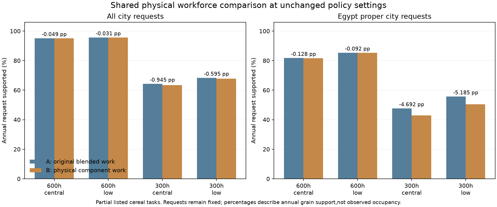

# Shared component work: small primary change, larger low-hours effect

The physical component-work comparison is complete and independently reviewed.
All six original annual Earth results still reproduce byte for byte. At
600 field hours, charging the actual base/floodplain task areas has a small
aggregate effect. At 300 hours it exposes a larger Egyptian shortfall. Neither
case changes town requests, calibrated shares, routes or the main atlas.



| Hours and density | Original A: city request supported | Physical work B | Added rural grain shortfall, person-years |
|---|---:|---:|---:|
| 600h central | 95.1267% | 95.0773% | 2,512 |
| 600h low | 95.6390% | 95.6076% | 2,461 |
| 300h central | 64.2613% | 63.3162% | 26,425 |
| 300h low | 68.3038% | 67.7091% | 28,575 |

At 600h central, annual grain production falls by 18,914 person-years, or
0.0131%; city grain support falls by 4,140 people across four city cells.
At 300h central, grain falls by 353,122 person-years and city support by 79,112
people across ten cells. These are annual food-support quantities at unchanged
requests, not observed city populations or predicted settlement abandonment.

Egypt proper is the existing diagnostic box
`29 ≤ longitude ≤ 32.6, latitude ≤ 32`, containing 39 city cells. Its central
city support changes 81.7406%→81.6122% at 600h and 47.6285%→42.9360% at
300h. The low-density stress changes 55.6504%→50.4651%. All material production
changes occur on basin source land; the maximum nonbasin numerical residual
is 3.14e-12 person-years. No city has a material support increase in these
four comparisons.

## What the comparison changes

The earlier [calendar audit](URBAN_EARTH_CALENDARS_20261116.md) identified that
the annual blended-yield work calculation charges tasks on 0.36 of arable
area, while its floodplain energy represents 0.95 cropping on the basin
fraction. A retains the original calculation exactly. B charges the existing
per-hectare crop work to the separate positive-energy activities:

- Base: arable hectares × (1 − basin share) × 0.6 × 0.6.
- Basin: arable hectares × basin share × 0.95.

Each of the 56,378 physical sources has exactly one rural workforce: 40% of
the unchanged rural population. Components share its 600h annual budget
(300h in the stress) and its 30 days × 8h reaping budget at every active
harvest boundary. Requests sharing a boundary are summed. One common retention
fraction scales all component activities and their grain, preserving the
potential crop mix. Zero-energy components are not charged as crop activities;
the 3,113 zero-production sources remain visible.

The 41 mixed cells with distinct base/basin dates retain those dates and share
the same annual workforce. No grain, people or worker budget is copied for the
second harvest. No new non-reaping task deadlines are invented.

Under these particular listed-task counts, reaping never binds: barley has
32 reaping hours within 208 listed hours per hectare, so the annual limit
allows at most 38.46% of the stated peak budget at 600h, and 19.23% at 300h.
The dates therefore have no extra work effect in this comparison. This does
not establish that real harvest labour, household work or transport is
unconstrained; the accounting still covers partial cereal field tasks.

## What stays fixed

Population remains the existing P2×history pattern, normalized to 61.4M on
empire land, with the original uniform urban withdrawal. City requests remain
8,371,325 central or 4,057,217 low, at the same 1,085 city cells. Grain potential,
crop calendars, rural food claims, transport and eligibility are unchanged.
The original central and low marketed shares, 0.3371937035110408 and
0.14049021985082757, are used at the original 270 road-km haul limit.

Those shares were interpolated from the old calibration grid. Re-evaluating
the actual annual allocator at an intermediate share need not yield exactly
95% support; that explains A's 95.1267%/95.6390%. No new share is fitted.
The original annual allocation averages the four actual 1981–2010 route
snapshots. It does not simulate seasonal stores, delayed shipments or meal
timing. The existing 600h central rural shortfall grows from 207,112 to 209,624
person-years; this is not all-rural food closure.

## Checks and artifacts

The unchanged Greek and low-reading runners reproduce their complete original
JSON bytes in separate processes. Their runtime prepare adapter recomputes
the original population, city demand, cereal choice, grain potential and
field support, requiring array identity, then reuses the verified actual
route arrays. The historical Greek `control_reproduces=False` flag remains
unchanged. No new Dijkstra run or transport physics claim is made.

The independent reviewer imports neither the new work model nor the canonical
work/flow allocators. It reconstructs component areas and scalar per-source
annual/monthly work constraints, then independently allocates annual grain
through a sorted shipment ledger. Across both work budgets it checks 225,512
physical source-cases, eight town allocations, 5,963 shipment rows and 1,820
basin CSV rows. Maximum residuals are 2.10e-12 person-years of source grain and
2.92e-10 people of town support. Twelve meaningful tests cover shared annual
work, coincident/distinct reaping dates, zero-energy activities, zero workforce,
common retention and invalid physical inputs.

The [qualification receipt](../output/urban_component_work_20261116/qualification.json),
[scenario table](../output/urban_component_work_20261116/scenarios.csv),
[all city rows](../output/urban_component_work_20261116/towns.csv) and
[regional table](../output/urban_component_work_20261116/regions.csv) retain
the complete comparison.
The [600h map](../output/urban_component_work_20261116/city_support_600.png)
and [300h map](../output/urban_component_work_20261116/city_support_300.png)
show city support differences; their color ranges differ. Compact town packets
and all receipts are tracked. The larger source-case arrays are ignored and
reproducible. All prior protected source and atlas identities remain unchanged.

## Next declared trial

The [fixed-request monthly-food protocol](../calibration/urban_diagnosis_20261116/seasonal_transfer_fixed_request_pilot.json)
chooses B as its work scenario and keeps the reviewed B600h annual calculation
as control. It preserves the original uniform global recruitment algebra,
both component harvest pulses and one physical workforce. It adds the stated
rural/export/town stores, stock losses, overflow protection and monthly routing
with leg delays. Central and low requests stay fixed; its output will describe
monthly meal shortfalls, not actual occupancy or a coupled demographic solution.

No main atlas/default adoption, empirical transfer upgrade, new source pool or
climate fitting follows from this diagnostic. Full diet, household/draft and
transport work, institutional rights and independent validation remain open.

## Reproduction

In a clean isolated output directory, with the qualified prior inputs present:

```sh
.venv/bin/python -m pytest -q tests/test_earth_component_work.py
.venv/bin/python scripts/urban_component_work.py --control greek
.venv/bin/python scripts/urban_component_work.py --control low
.venv/bin/python scripts/urban_component_work.py --hours 600
.venv/bin/python scripts/review_urban_component_work.py --hours 600
.venv/bin/python scripts/urban_component_work.py --hours 300
.venv/bin/python scripts/review_urban_component_work.py --hours 300
.venv/bin/python scripts/render_urban_component_work.py
.venv/bin/python scripts/seal_urban_component_work.py
```

Completed outputs are not overwritten by the scientific producer. For a fresh
replay use a fresh interpreter for each control, redirect the producer's runtime
`OUT` to an isolated directory, and point the reviewer/renderer/sealer there.
The 300h producer requires the passing 600h review. No existing artifacts need
deleting to reproduce this stage.
