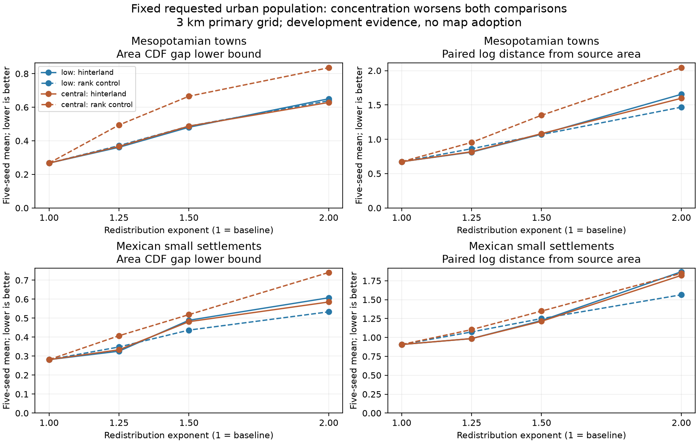

# Fixed urban-request concentration screen — 16 November 2026

Stronger concentration fails this development screen. Both the hinterland
predictor and the rank-stretching control worsen the five-seed mean area CDF
comparison and the paired area comparison at 3 km, under both existing density
readings. There is no surviving variant to integrate into the settlement map.
This rejects these particular redistributions at the tested exponents, not all
possible concentration mechanisms or a relationship between population and size.

The declaration, committed before any screen output, is
`calibration/urban_diagnosis_20261116/concentration_screen.json` (3c8fc2c99).
All 320 cases are retained: two source pools, two grids, five seeds, two density
readings, two weighting families and four exponents. Locations/counts are supplied
from the reviewed observed-site control. This is exposed development evidence,
not a site forecast, fresh blind test or calibrated demographic law.



## What was fixed

For every baseline and density reading, the sum of requested urban residents U
is fixed. Hinterland weights are baseline requests times normalized H to power
q−1; control weights are baseline requests times normalized baseline requests to
power q−1. The same bounded scalar allocation conserves U. Active sites retain
the resident bounds implied by 1–1,783 ha under that reading; zero-H sites stay
zero. Inverting the original density equation recovers areas without clipping
away people. All 80 q=1 controls reproduce the original areas and requests.

The regional population and remaining population budget also stay fixed.
Across 3 km seeds/readings, U ranges from 347,300 to 803,676 in Mesopotamia and
48,314 to 117,610 in Mexico. Each is below its full-window model population.
This is a **request budget**, not demonstrated food-supported urban population.
Neither actual migration nor origin-level rural labour, food or exports have
been recalculated. Those require the existing settlement-resident allocator.

## Complete primary-grid comparison

Values are five-seed means. Lower CDF gap/log distance is better; higher paired
interval hit is better. The Mesopotamian final source class is right censored.
The CDF statistic is a necessary lower bound, not an imputed exact KS or p-value.
Mexican reported areas are treated as exact for descriptive comparison; their
measurement precision is not a confidence interval. A paired exact hit there is
uninformative (zero throughout), so its continuous log error is reported.

|Source / reading / family|CDF gap q=1|q=1.25|q=1.5|q=2|Paired log distance q=1 → q=2|
|---|---:|---:|---:|---:|---:|
|Mesopotamia / low / hinterland|0.2672|0.3613|0.4807|0.6504|0.6734 → 1.6551|
|Mesopotamia / low / rank control|0.2672|0.3714|0.4874|0.6387|0.6734 → 1.4679|
|Mesopotamia / central / hinterland|0.2672|0.3664|0.4874|0.6286|0.6734 → 1.5969|
|Mesopotamia / central / rank control|0.2672|0.4941|0.6655|0.8353|0.6734 → 2.0428|
|Mexico / low / hinterland|0.2815|0.3259|0.4889|0.6074|0.9070 → 1.8693|
|Mexico / low / rank control|0.2815|0.3481|0.4370|0.5333|0.9070 → 1.5646|
|Mexico / central / hinterland|0.2815|0.3333|0.4815|0.5852|0.9070 → 1.8212|
|Mexico / central / rank control|0.2815|0.4074|0.5185|0.7407|0.9070 → 1.8482|

Every one of the 60 nonidentity Mesopotamian 3 km cases worsens its paired-seed
CDF gap. Some individual Mexican mild-exponent draws improve or tie that gap;
none of the declared group means improves. The paired continuous log-distance
means worsen at every tested nonidentity exponent in both pools/readings/families.
Mesopotamian paired interval hit falls from 24.2% at baseline to 8.7–11.1% under
q=2, depending on family/reading.

Larger maxima or more 200+ ha towns alone would suggest a misleading success.
For example, low-density hinterland redistribution raises Mesopotamian mean
200+ ha count from 1.4 to 4.2, against three source records, while the complete
distribution and paired metrics deteriorate. Under central rank control q=2,
an average 61.6 of 119 sites hit the minimum request. None hits the upper bound.
No tail-only winner is selected.

At 9 km every nonidentity group mean CDF gap also worsens. Five Mesopotamian
and seven Mexican points still have zero H, remain in all metrics, and make
paired mean log distance undefined/infinite. These fields are null with an
explicit zero-support count; they are not silently dropped. The coarse grid is
a resolution diagnostic, not an alternative primary test.

## Interpretation and next work

The baseline is too dispersed around the dominant source town band: among 119
Mesopotamian supplied towns, 87 are in the 10.1–20 ha class, while each seed
predicts 26–36 areas below 10.1 ha and also too many ordinary towns above 20 ha.
Concentrating the same residents further empties the middle. Simply raising
all sizes or selecting the prettiest upper tail is not supported.

The next useful step is a source/selection audit before another fit: distinguish
the Roman urban catalogue's area-availability and estimate-basis filters from
archaeological all-site cohorts and their ≥10 ha town selection. In particular,
the Roman fit excludes exact 20/30 ha defaults and combines extent definitions;
the survey town control selects its locations using observed area. Conditioning
draws on that same threshold would change the question and could hide failure
to predict town status. Any future conditional-size model must report town
membership/count error separately and declare its likelihood and blocked folds
before fitting. No new exponent search follows this negative result.

Mexico remains small-settlement evidence (largest selected population estimate
1,000); it cannot calibrate urban primacy or Old World density. Its estimated
population must not be treated as an independent census. Appropriate urban
development evidence, declared transfer, and a full origin/food/labour rebuild
remain necessary before map adoption. Climate stays parked.

## Verification and reproduction

The reviewer imports neither screen producer nor concentration/density component.
It independently evaluates scalar density equations, uses Brent roots for the
bounded request allocation and inverse area, and recomputes all metrics and CSV
cells against the retained source intervals. All 320 cases, 80 identity controls
and 44 tests pass. Three fresh numeric exports are byte identical. Maximum
budget error is 5.82e−10 people; largest independent request/area differences
are 6.54e−9 people and 5.83e−11 ha. All pinned prior artifacts remain unchanged.

Artifacts: `output/urban_concentration_20261116/` contains complete cases,
anonymous per-site request/area vectors, summaries, plots, hashes and review.
The primary input remains the reviewed corrected observed-site result; its
invalid affine first run is excluded and preserved separately.

```sh
.venv/bin/python scripts/urban_concentration_screen.py
.venv/bin/python scripts/urban_concentration_screen.py --out output/urban_concentration_20261116/fresh
.venv/bin/python scripts/review_urban_concentration_screen.py
.venv/bin/python scripts/plot_urban_concentration_screen.py
```
