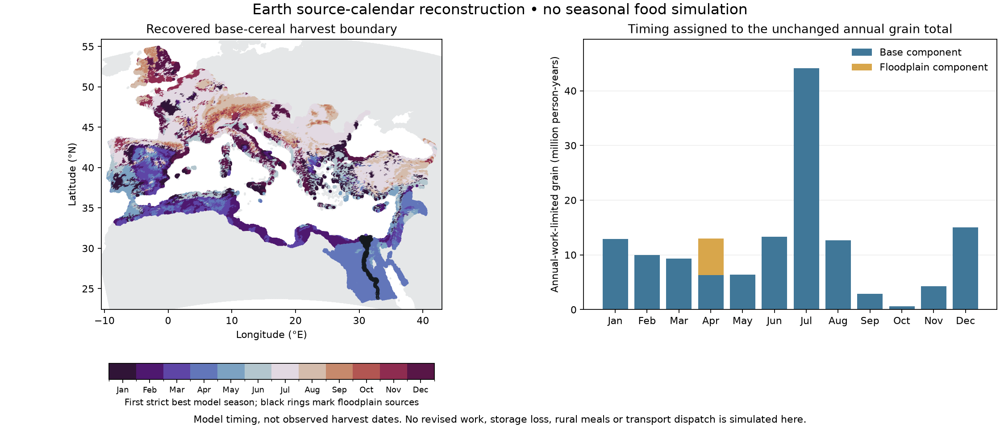

# Earth crop calendars recovered; component work is the next comparison

The original crop engine's calendars have been recovered and independently
reviewed for all **53,265 producing Roman source cells**, retaining the other
3,113 eligible zero-production cells. Original annual crop energies reproduce
exactly after their original float32 save; floodplain capacity reproduces
exactly in float64. These are model growing windows and maturity boundaries,
not observed harvest dates or a new seasonal food result.



The compact [calendar arrays](../output/urban_earth_calendars_20261116/calendars.npz),
[monthly energy table](../output/urban_earth_calendars_20261116/monthly_energy.csv),
[producer receipt](../output/urban_earth_calendars_20261116/results.json) and
[independent review](../output/urban_earth_calendars_20261116/review.json) retain
the full provenance. The prior [annual-control audit](URBAN_SEASONAL_TRANSFER_20261116.md)
remains unchanged, including its preserved wrong-period failure and six
byte-exact qualified controls.
The final [qualification receipt](../output/urban_earth_calendars_20261116/qualification.json)
seals the producer, independent review, figure and next-stage declaration.

## What was reconstructed

The 56,378 active physical source cells sample 54,324 unique 5arcminute crop
pixels. The original WorldClim temperature, rain and daily temperature-range
fields were read at those pixels, with the original latitude, irrigation,
Hargreaves evaporation, soil bucket, dtypes and solar convention. The original
`land_people.crop_yield` function selects the first strictly better window in
its existing enumeration order. Its saved growing masks determine sowing and
the boundary after the last occupied monthly bin.

The independent reviewer re-read all 36 monthly derived climate fields and
enumerated the crop windows without calling `crop_yield`. All reconstructed
energies and masks match exactly. Both crop energies at all 54,324 unique pixels
match the annual cache after float32 casting: **108,648 exact saved values**.
The maximum full-precision difference from the quantized stored crop energy
is below 0.125 kcal/ha; reconstructed higher precision never replaces the
stored annual production input.

The 455 floodplain source cells contribute 2.677% of total annual potential.
Their fully watered winter maximum is barley everywhere, with no crop tie and
no mismatch with the mixed-work crop choice. Their selected growing windows
avoid every saved catchment high-flow bin (`flow > 1`). All their model harvest
boundaries fall at the beginning of April. This is consistency with the saved
model flow, not independent evidence of actual flood recession or harvest.

Of the 285 cells with positive base and floodplain grain, **41 have different
component harvest boundaries**. They contain 7.275% of floodplain energy and
0.229% of total annual potential. Collapsing those dates into one cell-wide
harvest would discard recovered timing. The figure allocates the existing
annual work-limited grain to its recovered dates; it simulates no new peak
work, food stores, losses or trade dispatch.

## The work assumption that must be made explicit

The annual supply calculation chooses work per calorie from a blended yield,
then charges tasks on `0.6 × 0.6 = 0.36` of arable area. Its floodplain energy
boost represents `0.95` cropping on the floodplain fraction. Splitting physical
crop activities therefore requires a different task-area accounting:

```
annual blended-work area = arable hectares × 0.36
physical component area = arable hectares × [(1 − basin share) × 0.36 + basin share × 0.95]
```

On the 285 cells where both components produce grain, the physical-to-annual
task-area ratio ranges from **1.066 to 2.573**, with median **1.721**. At full
potential barley cropping, the difference is approximately **126M listed task
hours** across those cells. This is an accounting diagnostic, not an estimate
of actual work performed or a recalculated food shortfall. It changes none
of the existing annual budgets, outputs or calibrated shares.

The next declared comparison retains the exact original annual calculation as
control A and tests explicit physical component tasks as B, using one workforce
per physical source and shared annual and harvest-bin reaping limits. Grain
potentials, city requests, population and routes remain fixed. Comparisons use
the existing central/low marketed shares at the existing haul limit; there is
no share refit. The protocol is
[`seasonal_transfer_component_work.json`](../calibration/urban_diagnosis_20261116/seasonal_transfer_component_work.json).

After that comparison is independently reviewed, a separate seasonal pilot can
declare its work scenario, factorized global recruitment and multiple harvest
pulses. The protected fantasy interface currently expects sparse recruitment
and one boundary per source; the Earth adapter must preserve one physical
land, population and work ledger. No main atlas/default adoption, new evidence
pool, observed-date validation or climate fitting follows from this stage.

## Reproduction

Run the producer into an empty isolated output directory, after verifying or
rebuilding the prior annual controls and their prepared arrays:

```sh
.venv/bin/python scripts/recover_urban_earth_calendars.py
.venv/bin/python scripts/review_urban_earth_calendars.py
.venv/bin/python scripts/render_urban_earth_calendars.py
.venv/bin/python scripts/seal_urban_earth_calendars.py
```

The producer refuses to overwrite completed results. For a fresh replay, import
it in a fresh process and redirect its runtime `OUT` to an empty directory;
redirect the reviewers and renderer to that same output. The 9.5MB prepared
monthly arrays are ignored by Git; the 1.6MB compact calendar packet is tracked.
