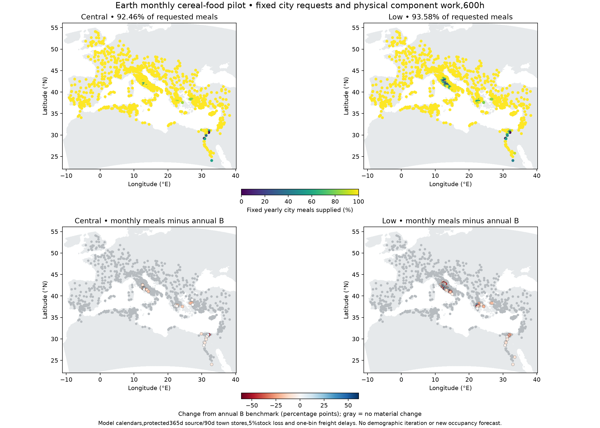
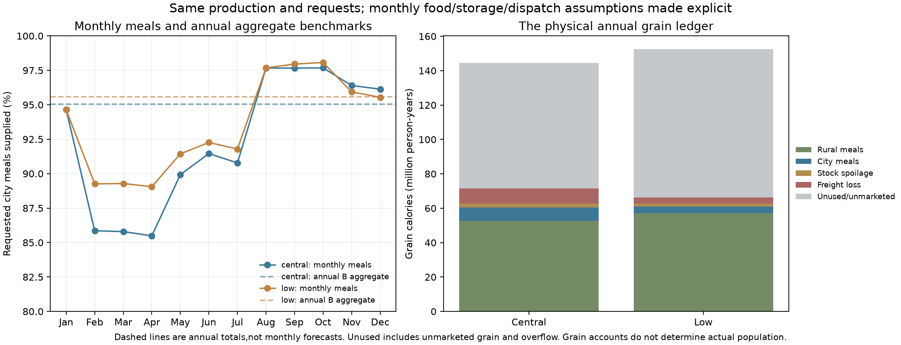

# Earth monthly cereal meals: reviewed fixed-request pilot

The first Earth monthly-food pilot is complete and independently reviewed.
At unchanged requests and calibrated shares, central city meal coverage is
**92.46%**, compared with **95.08%** support in the reviewed annual B model.
Low-density meal coverage is **93.58%**, versus **95.61%** annually.
These are conditional cereal-meal diagnostics at fixed population, not revised
city occupancy, an observed seasonal calibration or a main atlas update.



| Density | Annual B aggregate support | Monthly city meals supplied | City cells with full meals: annual→monthly | Rural grain shortfall: annual→monthly, person-years |
|---|---:|---:|---:|---:|
| Central | 95.0773% | 92.4578% | 1,071→1,046 | 209,624→218,953 |
| Low | 95.6076% | 93.5758% | 1,018→967 | 249,148→259,521 |

The central change is 219,280 fewer person-years of city meals relative to
annual B; the low change is 82,434. Total monthly urban meal shortfalls are
631,378 and 260,644 person-years respectively. Both rural and urban fixed
meal needs remain unmet somewhere; physical inventory closure does not mean
all people are fed.

Egypt proper, the same existing diagnostic box, has central monthly meal
coverage **76.6582%**, versus 81.6122% annually; low coverage is **80.9950%**,
versus 85.2320%. Network redistribution produces local gains as well as losses:
6 central city cells gain annual meal-equivalent supply and 32 lose it; low
has 40 gains and 77 losses. All city requests and locations remain fixed.

## The actual trial

The [reviewed component-work calculation](URBAN_COMPONENT_WORK_20261116.md)
supplies exactly the same B600h source production. It is recomputed and checked
bit for bit, along with its fixed-share annual city allocations, before any
monthly calculation. The original six-case annual controls remain unchanged.

Population remains 61.4M on empire land. Original central/low city requests,
rural population and one shared workforce per physical source are retained.
The global uniform recruitment identity is checked algebraically without
materializing a source-by-city matrix. Reconstructing the original rural
population by subtraction differs by at most 3.64e-12 people; the recorded
original rural arrays are used for all needs and work.

Each source receives its separate base and floodplain grain pulses at the
recovered original-model harvest boundaries. Coincident pulses are added,
and the 41 mixed cells with different component dates retain both dates.
No physical source's production or workers are duplicated.

The declared scenario then applies:

- Twelve equal 365/12-day bins, January-indexed.
- Rural stores holding 365 days of fixed rural meals, with 5% annual loss
  on stored grain. Only overflow from rural years meeting their meal tolerance
  can be marketed; the existing fraction applies to that overflow.
- Separate export stores holding 365 days of annual marketed grain. Monthly
  dispatch targets an even share of that total, subject to physical stocks
  and route availability.
- The original actual 1981–2010 source-owner and freight snapshots, held over
  their respective three monthly bins. Every leg arrives one bin later.
- Town stores holding 90 days of fixed request meals, with the same stock-loss
  rule. Only locally meal-protected towns export actual overflow; shipments
  follow the unchanged cheapest-first rule toward next-bin deficits.

The protected fantasy inventory and routing helpers are reused without
changing them or invoking their demographic allocator. An isolated Earth
adapter supplies the multiple crop pulses. No city population is reduced to
its food coverage, no staff is recalculated and no demographic fixed point
is claimed.



Central aggregate meal coverage is lowest in April, at 85.49%; low is also
lowest in April, at 89.05%. This is a result of the combined declared calendar,
storage, export and routing recipe. The annual→monthly comparison does not
identify the causal effect of storage loss or calendar timing alone.

Unmarketed/unused grain, store spoilage and grain paid in freight are explicit
parts of the physical ledger. A large unused total does not establish that
it can reach deficient towns under these route and protection rules. Stocks
and transit repeat across the year boundary; inherited stock is not hidden
new production.

## Independent checks

The independent reviewer replays every rural, export, local-town and final-town
inventory with the original canonical bisection kernel, rather than the
analytic repeating-stock helper used by the producer. All paths and fields
pass at the original 1e-10 relative inventory tolerance; the maximum discrepancy
is 0.57649 of that tolerance. Source and town food-eligibility flags agree.

It also reconstructs both component pulses, fixed population identity,
source export protection, dispatch and all source arrivals, then builds an
independent monthly sorted shipment ledger. Source arrivals match exactly;
all **15,896 shipments** are reproduced. The combined check covers 112,756
physical source-cases and eight vectorized inventory groups. The full grain
ledger closes within **1.72e-8 person-years**, including rural/city meals,
all stock losses, unmarketed/unused grain, both freight losses, stock changes
and cyclic transit. Seven adapter tests passed, including distinct/coincident
harvests, hungry-origin export exclusion, blocked routes, cyclic leg delay and
zero-harvest food accounting.

The [qualification receipt](../output/urban_earth_monthly_20261116/qualification.json)
seals both reviewed cases and the presentation.
[All 2,170 city rows](../output/urban_earth_monthly_20261116/towns.csv),
[24 monthly rows](../output/urban_earth_monthly_20261116/months.csv),
[regional results](../output/urban_earth_monthly_20261116/regions.csv) and a
[compact town packet](../output/urban_earth_monthly_20261116/town_model.npz)
are tracked. Large source/stock arrays are ignored and reproducible.
All prior protected source, result and atlas identities remain unchanged.

## What comes next

The harvest dates are the original crop engine's first strictly best windows,
not observed planting/harvest records. Equally productive windows may have
different maturity dates. Before fitting anything or adopting seasonal map
changes, the next [frozen timing-sensitivity protocol](../calibration/urban_diagnosis_20261116/seasonal_transfer_calendar_sensitivity.json)
enumerates exact equal-energy windows and tests two explicitly declared timing
alternatives, retaining unchanged production, population, work, routes and
shares. Earliest/latest calendar choices are attainable model scenarios, not
network-wide robustness bounds, probabilities or observed farming calendars.

The existing evidence is already exposed development material. City requests
are area multiplied by density assumptions, including imputed areas. The
work scenario still covers partial cereal field tasks; full diet,
household/draft/transport work, institutional rights and independent transfer
validation remain open. No climate fitting, new source pool or atlas/default
adoption follows from this pilot.

## Reproduction

After verifying the committed parent qualifications and prepared annual inputs,
run into an empty isolated output:

```sh
.venv/bin/python -m pytest -q tests/test_earth_fixed_food.py
.venv/bin/python scripts/urban_earth_monthly.py central
.venv/bin/python scripts/urban_earth_monthly.py low
.venv/bin/python scripts/review_urban_earth_monthly.py central
.venv/bin/python scripts/review_urban_earth_monthly.py low
.venv/bin/python scripts/render_urban_earth_monthly.py
.venv/bin/python scripts/seal_urban_earth_monthly.py
```

The producer refuses to overwrite completed cases. For a fresh replay redirect
its runtime `OUT` in a fresh interpreter, then redirect review/render/seal to
that output. The earlier component and original annual controls are preserved.
