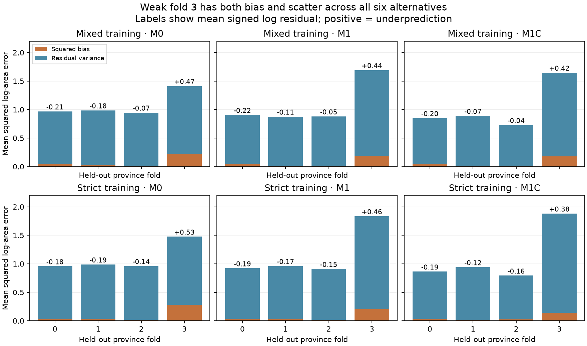

# Fixed geographic error audit — 16 November 2026

The weak province fold combines systematic underprediction with extra scatter.
It is neither just one erroneous town nor primarily a test outside the training
hinterland range. A source/input provenance check is the next useful step;
changing the size exponent or dropping this geography is not supported.

The audit follows `geographic_residual_audit.json`, committed in 9b85fe35e before
decomposition. It uses only the 153 common target records and six fixed reviewed
prediction/sigma vectors. There is no fit, new predictor, candidate selection,
new source score or map/default change. Climate remains parked.



## What drives fold 3

Residual means observed minus predicted log area: positive means underprediction.
Each error is decomposed exactly as MSE = squared mean residual + centered mean
squared residual. The latter is a descriptive spread, not an unbiased variance
estimate. Fold 3 contains 36 targets in ten provinces, including two capitals.

|Training / model|Mean signed residual|Squared bias|Centered mean square|Top 1 / 5 / 10 share of squared error|
|---|---:|---:|---:|---:|
|Mixed M0|+0.470|0.221|1.193|21.5% / 52.3% / 76.2%|
|Mixed M1|+0.438|0.192|1.501|21.6% / 60.1% / 79.2%|
|Mixed M1C|+0.421|0.177|1.469|21.1% / 60.0% / 79.4%|
|Strict M0|+0.533|0.284|1.193|19.8% / 51.2% / 76.0%|
|Strict M1|+0.457|0.209|1.627|20.7% / 61.7% / 80.1%|
|Strict M1C|+0.380|0.145|1.738|20.0% / 61.6% / 80.2%|

No top-error removal score is computed: these are shares of the unchanged
all-record error, not permission to exclude those records. Other folds also
have concentrated errors; for example mixed M1's largest-error shares are
25.0%, 17.2% and 19.4% in folds 0–2. Fold 3's poor result is not uniquely
explained by a single large error. Even a retrospectively fitted fold intercept
would leave high centered error, and no such intercept is fitted here.

The Gaussian log-area score is decomposed into log normalization plus half the
mean squared standardized residual. For mixed M1 fold 3 these are 0.947 and
0.801 (total 1.748), versus standardized components 0.410/0.383/0.386 in folds
0–2. Strict M1C fold 3 is more underdispersed: normalization 0.816 plus 1.157
(total 1.973). Its variance estimate came only from the other training provinces;
the mismatch remains a held-out failure, not a reason to recalibrate on fold 3.

## Predictor support and province accounting

Only two of the 36 fold-3 H values fall below the training minimum, under both
training-cohort definitions and all models. They are not above its maximum.
For mixed training, H ranges from 862 to 347,571 people, with median 17,645;
fold-3 targets span 82 to 160,588, with median 26,769. Strict training has a
similar upper overlap. Thus range extrapolation alone cannot explain the
whole fold. Range overlap does not certify that H is measured correctly or
captures the relevant food-access relationship.

All 40 target provinces are retained in every alternative, including 29 with
fewer than five targets. These are marked small, not removed. Province codes
remain the anonymous codes of the frozen pilot; this stage makes no new source
identity join. For illustration, mixed M1 fold 3 includes:

|Anonymous province|Targets|Mean signed residual|Contribution to squared-error sum|
|---|---:|---:|---:|
|1|11|+1.441|30.811|
|40|1|−3.626|13.145|
|33|7|+0.220|7.587|
|12|4|+0.566|3.084|
|10|4|−0.590|2.125|

The eleven province-1 targets are all underpredicted: their mean signed error
equals their MAE. One province-40 target has the large opposite error. Both
patterns stay in all metrics. The four strict target capitals cannot explain
the complete failure: mixed M1 fold 3 has 34 noncapital targets with mean
residual +0.413 and MSE 1.717, alongside two capitals with +0.865 and MSE 1.290.
These tiny capital samples do not establish a general administrative effect.

## Next bounded audit

`hinterland_provenance_audit.json` now declares a complete aggregate province
crosswalk and H-input provenance audit. It will join all province codes to the
existing source labels and trace the size-fit population field separately from
current Earth supply and fantasy-map population inputs. This matters because
an updated food/supply calibration does not itself prove that the older city-
size covariates were rebuilt. No source identity or causal mechanism is inferred
from the anonymous codes here.

Only a certified comparable population field could support a paired input
refresh. A harvest/supply variable must not be silently substituted for people.
If no aligned current field exists, that limitation should be recorded. Later
food-access networks or administrative predictors need independently supported
inputs and a new declaration; residual correlations cannot supply causal labels.
No province-specific multiplier, geography exclusion or new exponent search is
authorized by this diagnostic. Reserved Buringh sizes and climate l stay closed.

## Verification

Independent scalar sums, direct Gaussian equations and sorted-list quantiles
recompute 24 fold cases, six pooled cases, 240 province cases and 48 capital
groups. Five hand arithmetic controls cover decomposition, top-error shares,
zero errors, empty groups and quantile interpolation. All 7,878 CSV cells match;
five fresh numeric exports are byte identical. Fold, province and capital
accounting all recover the same 153 targets, four capitals and total MSE.
Prior reviewed predictions and scientific artifacts remain unchanged.

Complete outputs and hashes: `output/urban_geographic_residuals_20261116/`.

```sh
.venv/bin/python scripts/urban_geographic_residual_audit.py
.venv/bin/python scripts/urban_geographic_residual_audit.py --out output/urban_geographic_residuals_20261116/fresh
.venv/bin/python scripts/review_urban_geographic_residuals.py
.venv/bin/python scripts/plot_urban_geographic_residuals.py
```
