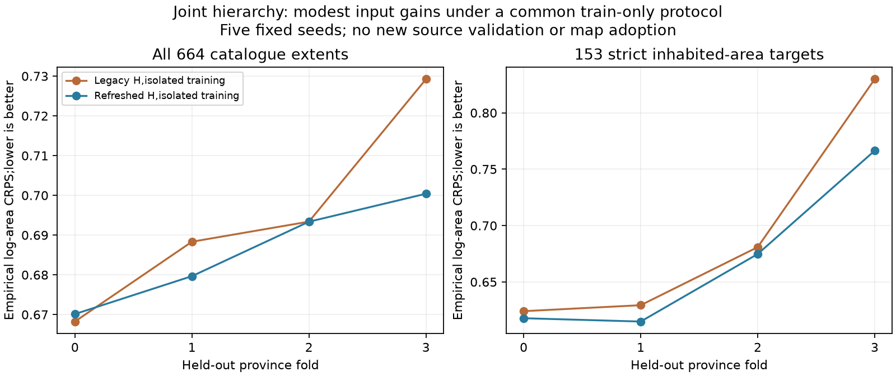

# Train-only joint hierarchy comparison — 16 November 2026

The refreshed H inputs modestly improve the joint hierarchy's paired forecasts
under a common, repaired training protocol. Empirical log-area CRPS improves
1.08% over all 664 source records and 3.21% on the strict 153-record sensitivity.
Median-forecast errors improve too. Overall size-distribution KS is slightly
worse; all eleven strict Egyptian targets remain underpredicted. No coefficient
or map is adopted from this exposed development trial.

The trial was declared in `hierarchy_refresh_trial.json` at 3b08f56ab before any
new joint fit. It compares two H inputs using the existing residual-selection
family, existing capital labels, old phi/c grid, five seeds and fixed bounds.
All source records remain in area forecasts. The strict subset is a measurement-
basis sensitivity, not a new pool or independent validation.



## Training isolation and comparison scope

For each of the eight variant/outer-fold fits, M1 means fit only outer training
areas. Inner province folds supply out-of-fold training means and RMS predictive
sigma. Only training capitals and pairs with **both endpoints in training**
enter selection of phi/c. The final test means use all outer training rows;
no outer-test area enters coefficients, sigma or parameter choice.

The 70 existing choices per fit produce 560 preserved training losses. Generation
uses the original clipped normal draws, maximum-residual swaps toward centres,
member-order RNG and bounded areas. Bounds apply consistently during selection
and prediction. Positions/capital labels for all known sites are conditional
inputs, including unlabelled test-site geometry; this is not a location forecast.

The historical hierarchy fit used globally prepared scatter/means and ratios
that could reference held-out centres. Its archived gate and owner's adoption
remain unchanged. Both alternatives here use the corrected protocol, so only
their paired difference isolates H. These results are not claimed to reproduce
the old archived validation numbers.

Of 95 source subordinate edges, 76 have both endpoints in the same outer fold
(29/24/12/11). Those supply held-out hierarchy metrics. All 19 cross-fold edges
remain disclosed, and all 664 towns retain area scores. The observed median
ratio for these 76 edges is 0.1677, different from the old 95-edge cohort's 0.1087;
the two source summaries must not be interchanged.

## Complete aggregate results

CRPS scores the five-draw empirical distribution of log area; it is not a p-value
or a calibrated source measurement-error interval. Point errors use the median
of those five log-area forecasts. No new deterministic-mean NLL is substituted
for the joint random hierarchy.

|Input / cohort|Empirical log-area CRPS|Median log-area MAE|Median log-area RMSE|
|---|---:|---:|---:|
|Legacy / all 664|0.6911|0.9416|1.1751|
|Refreshed / all 664|0.6837|0.9310|1.1625|
|Legacy / strict 153|0.6855|0.9243|1.1536|
|Refreshed / strict 153|0.6635|0.8972|1.1187|

The primary MAE improves 1.12%, strict MAE 2.93%. Primary CRPS improves in three
of four folds and worsens slightly in fold 0 (0.66825→0.67013); strict CRPS
improves in every fold. This is a smaller and less uniform gain than the earlier
standalone Gaussian pilot. The strict Egyptian median-forecast mean log residual
falls from +1.425 to +1.191, but all eleven remain underpredicted.

|Five-seed mean|Legacy H|Refreshed H|Observed comparator|
|---|---:|---:|---:|
|All-record area KS|0.0536|0.0551|Exact reported source areas|
|All-record total-area ratio|1.0399|1.0332|1.0|
|Strict-record area KS|0.0967|0.0980|Exact reported source areas|
|Strict-record total-area ratio|1.0647|1.0579|1.0|
|Closed-pair subordinate exceed share|9.21%|8.95%|6.58%|
|Closed-pair median subordinate/centre ratio|0.16806|0.16765|0.16770|
|Implied capital factor|3.584|3.571|3.218 legacy / 3.139 refreshed|

The capital-factor observed comparator is relative to each alternative's held-out
M1 mean, so it changes with that mean; the source areas themselves do not change.
Strict-only hierarchy metrics are not claimed. The strict set has only four
capitals and does not define a homogeneous closed hierarchy cohort.

The selected phi/c choices are identical between H alternatives within each
fold: (0,1.1), (1,0.9), (0.75,0.6), (1,0.6). The eight coefficient/sigma receipts
and every training loss are retained. No full-data map fit is made here.

## Concrete next build

`hierarchy_candidate_build.json` declares an isolated development candidate:
fit final parameters on the complete exposed source, then rebuild sizes and
the legacy annual people/local-cereal ledgers on **fixed released** raw/corrected
fantasy sites. Published population, counts, positions, actors, marks, climate,
roads and campaign ordering remain inputs. An unchanged published-model control
must reproduce released artifacts before the candidate is interpreted.

This candidate is a preview of the application assumption that all marked
fantasy places receive centre residual selection. It is not independent transfer
or a fully feasible seasonal-food result. The existing finite-origin allocator,
joint source/destination food audit, work-supported production, supply, staffing
and reach/trade checks remain necessary before adoption. A later chain update
must account for every affected artifact and an appropriate evidence/transfer
strategy. Buringh sizes and climate l remain closed; climate remains parked.

## Review and reproduction

The reviewer independently rebuilds the haversine source graph, QR mean fits,
scalar inner-OOF sigma, all 560 losses/eight choices, residual swaps, bounded
areas, empirical CRPS, point/CDF and closed-pair metrics. It imports no trial
producer, hierarchy component or nested-fit component. Fixed RNG and the
previously reviewed source-cohort reader are explicitly reused.

All 6,356 CSV cells match. Eight fresh numeric files reproduce exactly; largest
independent area difference is 2.73e−12 ha. Four tests verify outer-label isolation
(including capitals), both-endpoint pair closure, residual multiset/bounds and
hand-calculated empirical CRPS. Protected prior outputs and published files are
unchanged. Artifacts: `output/urban_hierarchy_refresh_20261116/`.

```sh
.venv/bin/python scripts/urban_hierarchy_refresh_trial.py
.venv/bin/python scripts/urban_hierarchy_refresh_trial.py --out output/urban_hierarchy_refresh_20261116/fresh
.venv/bin/python scripts/review_urban_hierarchy_refresh.py
.venv/bin/python scripts/plot_urban_hierarchy_refresh.py
```
