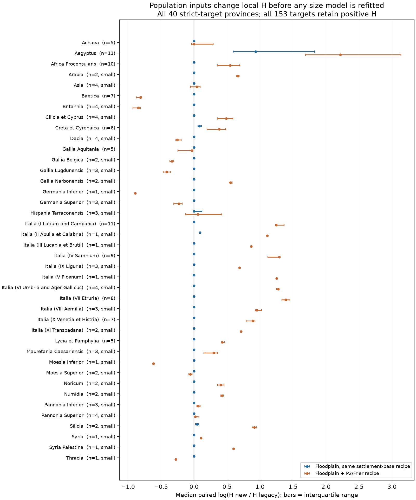

# Matched population-input replay — 16 November 2026

The already qualified floodplain harvest is restored **byte for byte**. On the
fixed Roman geometry it materially changes Egyptian hinterland inputs even
under the existing settlement-base population recipe. A separate P2/Frier
population recipe changes them much more. These effects should be tested
separately before attributing the size failure to a new concentration mechanism.

This is an input comparison, not a new predictive score or population census.
No area model, density parameter, urban fraction, climate fit or published map
is changed. All 664 original eligible records and 153 strict targets remain;
all retain positive H under all three recipes.

## Exact restoration and compatibility record

The experiment was declared in `population_recipe_replay.json` at b3f2e7af8.
The unchanged historical wrapper initially failed before crop analysis: the
newer generic caller passes `extra_crops=None` and `old_world=True`, but the
older wrapper's closure has the older signature. The failure receipt, log and
exact restorer snapshot are preserved in `failed_legacy_wrapper/`.

Compatibility amendment A1 (055c6a051) was committed before retry. A runtime
adapter removes only those redundant Old World defaults and rejects any new
crop or nondefault world request. It leaves the archived wrapper, formulas and
parameters untouched. Six forwarding/rejection controls pass.

The retry reproduces global grid SHA
`3b57d0cba03802d3693eb46e661771d6375715dc2f17f8555217ff0ff33fb338`,
exactly matching the qualified supply input. Regional summary bytes match the
archive, and all 1,275 qualifying cells are recovered. Previously published
atlas assets and historical artifacts stay unchanged. This replays already
exposed observed-weather harvest/water calculations; it is not new climate work.
Large restored arrays remain isolated, ignored cache artifacts.

## Fixed comparison

All variants use the same 9 km mesh, land/allowed masks, legacy history field,
1,315 distinct catalogue centre cells, 60 km cutoff and exact-tie ownership.
Legacy H reproduces the frozen design. Multiple catalogue rows in one occupied
cell retain the same covariate; their sum is not a separate population budget.

|Input population recipe|Window people, million|Allowed Roman-land people, million|Assigned centre-H mass, million|Unassigned people, million|
|---|---:|---:|---:|---:|
|Immutable legacy density|119.354|54.040|47.259|72.095|
|Floodplain, existing settlement-base × occupation|121.021|55.211|48.700|72.321|
|Floodplain capacity × history, P2/Frier|103.518|61.400|58.661|44.857|

The P2 factor is the existing supply normalization 1.1933421; it is not fitted
to town areas. Window and allowed-land totals differ because the window includes
land beyond the Roman mask. H ownership uses the same full land window as the
original calibration. No source count or boundary is changed to improve a fit.

## Egyptian inputs change substantially

For the eleven strict Aegyptus targets:

|Recipe|Median H, people|Median paired H ratio to legacy|Median paired normalized H-share ratio|
|---|---:|---:|---:|
|Legacy|8,355|1.00|1.00|
|Floodplain, same settlement-base recipe|38,017|2.55|2.51|
|Floodplain + P2/Frier|124,747|9.19|10.60|

The median **paired ratio** differs from the ratio of group medians: the
individual towns change by different amounts. Normalized H shares use the
variant's full-window population as denominator and are descriptive only;
they do not replace the absolute densities or hide changes in regional totals.

Across all 664 mixed records, the median paired H change under the same-recipe
floodplain input is exactly zero: the effect is geographically uneven. For the
P2/Frier recipe, median paired H rises by about 1.53× across mixed records and
1.67× across strict records. Its many zero-density land cells do not imply that
the historical land was uninhabited; this is a modeled capacity/history pattern.
Every fixed source centre still receives positive total H.



All 51 province summaries are retained under both mixed and strict selection,
including empty strict cohorts and small samples. Log-change summaries are
explicitly conditional on positive pairs; zero-H counts are retained alongside
them. Here all eligible pairs remain positive, so no record disappears.

## What this does and does not establish

The size calibration's old population inputs miss an input change that is
material for the geography where it underpredicts. This makes a controlled
Earth input-refresh predictive test worthwhile. It does not establish that
updated H fixes size skill, validates Egyptian extent dates, or explains the
opposite small-settlement error in Moesia Inferior. Current supply success still
does not certify city-size predictions.

The next frozen pilot (`population_refresh_pilot.json`) compares legacy H with
the same-recipe floodplain H, on the same held-out targets and nested training
folds. It keeps intercept-only and existing-capital controls. P2/Frier remains
an input sensitivity here; using it alone for size calibration would change
the population recipe relative to fantasy application. No new exponent grid,
province multiplier or residual-based exclusion follows this comparison.

Any successful Earth pilot still needs explicit consistency with the actual
fantasy population/harvest inputs, an appropriate declared transfer test and
full origin/food/labour reconstruction before map adoption. Reserved Buringh
sizes and climate l remain closed; climate remains parked.

## Verification

Independent review reuses only unchanged biome classification and the previously
reviewed legacy row mapping. It separately evaluates the population equations,
nearest-pixel sampling and Frier normalization, then assigns every land cell
using brute-force distances to all centres with full ties and the 60 km radius.
All three mass budgets, six cohort summaries, 306 province summaries and 7,503
CSV cells pass. Five fresh numeric exports reproduce exactly. Six adapter
controls pass. Exact restored grid/region identities and prior protected files
are also checked. No independent density claim relies on calling the producer's
population function.

Artifacts: `output/urban_population_recipe_20261116/`. Reproduction:

```sh
# Isolated restoration only; canonical historical outputs are untouched:
.venv/bin/python scripts/restore_urban_population_inputs.py
.venv/bin/python scripts/urban_population_recipe_replay.py
.venv/bin/python scripts/urban_population_recipe_replay.py --out output/urban_population_recipe_20261116/fresh
.venv/bin/python scripts/review_urban_population_recipe.py
.venv/bin/python scripts/plot_urban_population_recipe.py
```
