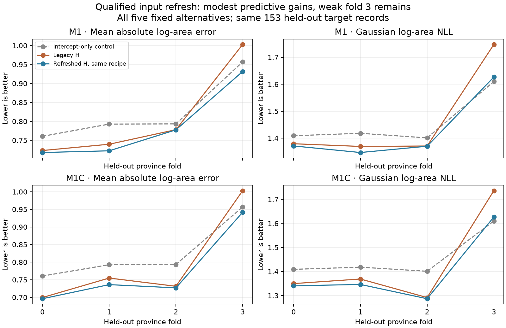

# Controlled population-input refresh — 16 November 2026

Using the qualified floodplain harvest with the **same population recipe**
improves held-out city-area predictions modestly. Both fixed architectures
improve pooled MAE/RMSE and proper log score; log score improves in all four
province folds. The Egyptian underprediction remains substantial. This is a
useful development result, not a qualified map update or a demonstrated cure.

The frozen declaration is `population_refresh_pilot.json` at 9e19c70ef, before
the new fit. All 664 mixed training records, 153 strict held-out targets,
existing capital labels and province folds remain unchanged. No weak fold or
source observation is excluded. P2/Frier is not a predictive candidate: it
would change the population recipe as well as the harvest input.



## All fixed alternatives

Outer training uses the other three province folds. Predictive sigma is the
RMS of inner out-of-fold training residuals, without any outer-test area. No
full-data sigma, extra parameter grid, random draws or area clipping is used.
All 80 outer/inner supports pass the declared sample/rank checks. The original
intercept-only and two legacy-H prediction/sigma controls reproduce **exactly**.

|Alternative|Log-area MAE|Log-area RMSE|Gaussian log-area NLL|80% coverage|95% coverage|
|---|---:|---:|---:|---:|---:|
|Intercept-only control|0.8225|1.0362|1.4572|82.4%|96.7%|
|Legacy M1: H|0.8047|1.0383|1.4615|82.4%|95.4%|
|Legacy M1C: H + existing capital|0.7930|1.0120|1.4343|83.0%|96.1%|
|Refreshed M1: H|0.7815|1.0021|1.4242|83.0%|96.1%|
|Refreshed M1C: H + existing capital|0.7714|0.9779|1.3986|82.4%|96.7%|

Against its same-architecture legacy control, refreshed M1 reduces MAE 2.89%
and RMSE 3.49%; its NLL changes by −0.0373 nats per target. Refreshed M1C reduces
MAE 2.72% and RMSE 3.37%, with NLL change −0.0357. These are pooled comparisons
on exposed development observations, not independent source validation or a
post-hoc adoption threshold.

|Architecture / input|Fold 0 NLL|Fold 1 NLL|Fold 2 NLL|Fold 3 NLL|
|---|---:|---:|---:|---:|
|M1 legacy|1.3792|1.3693|1.3708|1.7478|
|M1 refreshed|1.3711|1.3467|1.3701|1.6267|
|M1C legacy|1.3497|1.3688|1.2916|1.7363|
|M1C refreshed|1.3404|1.3462|1.2868|1.6268|

MAE improves in every fold as well. RMSE increases slightly in fold 2 for both
architectures, so this is not uniform improvement in every metric. Fold 3
remains weakest, and its refreshed NLL is still worse than the intercept-only
control's 1.6102. Nominal 80% coverage there rises from 69.4% to 72.2%; 95%
coverage rises from 91.7% to 94.4%. The remaining undercoverage stays visible.

For Aegyptus's eleven strict targets, mean signed log residual changes from
+1.441 to +1.207 for M1 and +1.466 to +1.264 for M1C. **All eleven remain
underpredicted**. The input refresh explains part of a predictive weakness;
it does not supply missing extent dates or certify a transport/administrative
cause. There are only four capital-labelled strict targets overall, so neither
architecture establishes broad primacy skill.

## What can proceed

Input consistency is a better-supported immediate direction than stronger
concentration: the declared concentration redistributions worsened predictions,
whereas this fixed-input update improves both paired and proper scores. It
still tests standalone log-area regressions, not the published hierarchy's
centre/subordinate random-draw construction or the full food/worker ledger.

The next declaration, `integration_readiness.json`, audits actual released
fantasy harvest/population packets, existing floodplain-port evidence and the
full hierarchy/ledger dependency chain. Same formula does not establish that
Earth's refreshed harvest and the published fantasy harvest have equivalent
physical inputs. The owner deliberately retains fantasy climate r44; this audit
must not reopen climate fitting or silently replace it with Earth r46.

A later full-hierarchy comparison needs its own train-only uncertainty and
source/transfer gates. Campaign centre labels cannot be inferred from observed
areas. Successful prediction on these reused targets does not eliminate the
need for appropriate transfer and a complete origin/food/labour rebuild before
any map adoption. No fitted coefficient or atlas default changes here. Buringh
sizes and climate l stay closed.

## Verification

The independent reviewer uses GELSY QR OLS and scalar nested variance, with the
previous independently implemented scalar normal-score arithmetic. It checks
all 20 outer cases, 60 inner fitted receipts, 80 support splits, 765 predictions,
200 province cases, 40 capital groups and 10,070 CSV cells. Three prior controls
are bit exact; seven fresh numeric files reproduce byte for byte. Four tests
check label isolation, nested uncertainty accounting and support rejection.
Protected prior files and physical/published inputs remain unchanged.

Outputs: `output/urban_population_refresh_20261116/`.

```sh
.venv/bin/python scripts/urban_population_refresh_pilot.py
.venv/bin/python scripts/urban_population_refresh_pilot.py --out output/urban_population_refresh_20261116/fresh
.venv/bin/python scripts/review_urban_population_refresh.py
.venv/bin/python scripts/plot_urban_population_refresh.py
```
