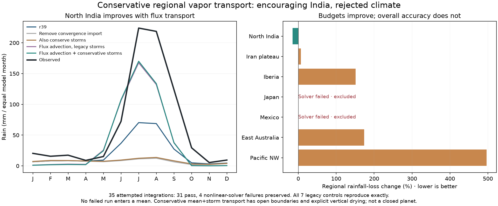

# Conservative regional vapor transport: better India, rejected climate

The opt-in `moisture_transport_form="flux"` solves shared-face upwind vapor
transport instead of concentration advection. Each internal face exports
exactly what its neighbor imports. Positive-only convergence import must be
zero; enabling both is rejected. The surface heat equation keeps its legacy
solver. The separate moisture solver uses monotone Gauss-Seidel and the saved
strict tolerance/cap/recovery settings. Both solvers enter numerical certificates.

The regional steady vapor ledger includes prescribed outer-ring exchange,
uniform diffusion, net evaporation minus column drying, storm exchange and
rain. Full horizontal transport is conservative only when storm exchange is
also conservative. This is a flat regional grid with fixed boundary reservoirs,
not a transient atmospheric or closed-planet water cycle.

Known-answer tests preserve constant transported vapor flux in a divergent
flow, verify face row signs and solver-operator agreement, nonnegative coupled
water/rain, boundary cancellation and the complete regional ledger. Default
concentration transport remains unchanged. The79 focused model/numerical tests
and three pilot guards pass before real-region integrations.

## The frozen five-profile pilot

Seven reused regions at56km compare: r39 unchanged; no convergence import;
no import with conservative storms; flux advection with legacy storms; flux
advection with conservative storms. Only the last may qualify. Exact archived
float32 monthly fields/observations and geography are required for all seven
unchanged controls. Planetary forcing, other r39 physics and strict numerical
criteria stay fixed.

All35 attempts finish: **31 pass, four fail the nonlinear moisture solve**.
The default controls reproduce exactly. Both flux schemes fail Mexico at the
first seasonal step and Japan at step4, after256 moisture iterations:

| Scheme | Mexico scaled residual | Japan scaled residual | Required maximum |
|---|---:|---:|---:|
| Flux / legacy storms | 1.57125 | .413221 | .01 |
| Flux / conservative storms | 1.23945 | .0101302 | .01 |

Those failures remain excluded, without relaxed thresholds or aggregate
substitution. No full31/ocean-finalist/fine/established-six stage runs.

For the successful North India cases, annual rain changes from256 to85 mm
when the old import is simply removed, or94 mm with conservative storms too.
Conservative flux transport restores479–482 mm, closer to761 observed.
The conservative mean+storm scheme's North India rain loss falls from.94179
to.80227 (14.8% improvement); its combined local S is.95050.

That local gain does not qualify the model. Iberia rises to1057 versus392 mm
observed, eastern Australia1722 versus641, and Pacific NW3966 versus897.
Their combined errors rise substantially. Iran changes to166 versus232 mm,
with slightly worse local combined error despite the closer regional mean.
No average over just the successful regions is presented as overall skill.

Successful conservative runs have relative mean-wind/diffusion flux cancellation
around1–2e-16 and pass the existing steady equation residual threshold.
Conservation is a software/structural gain; rainfall accuracy remains a separate
requirement. The next controlled follow-up will test the moisture-column wind
and numerical stiffness, preserving this original failed source epoch.

## Reproduction and publication

Source commit`08b3a23` contains the implementation, recorder and predeclared
`calibration/vapor_flux_20261026/plan.json`. Results, every failure and input
identity are retained under`output/vapor_flux_20261026/`. Source changes require
a new folder; do not reinterpret the completed records under a modified helper.
Local NPZ caches are optional and hash-bound; the browser companion has its
own portable PNG and JSON. The r39 qualified profile and all three normal
atlas climate/food/population/trade datasets stay unchanged.

