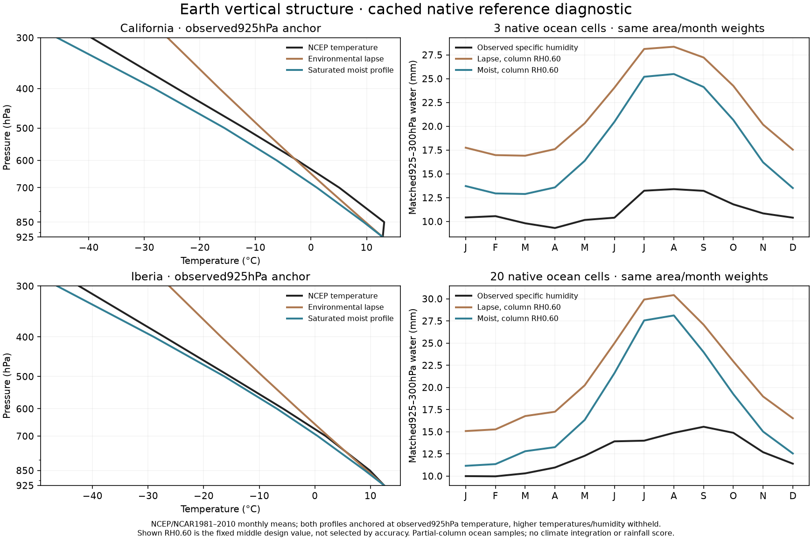
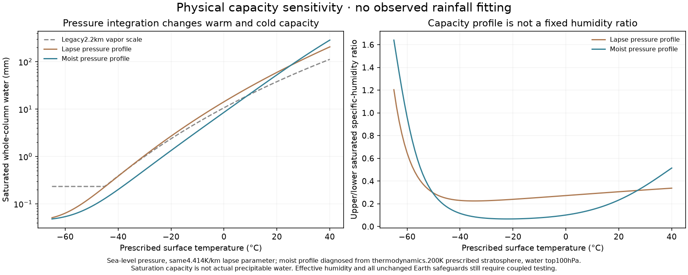

# Earth vertical thermal and humidity structure

This cached-reference audit checks the new pressure profiles against NCEP/NCAR
1981–2010 pressure-level climatology. It performs **no climate integration,
rainfall fitting or atlas adoption**. The six profile/humidity combinations
were already declared in the running Earth pilot; this audit does not change
that plan or select a fitted candidate.

The exact existing native ocean footprints are reused:3 cells off California
and20 around Iberia,187971 and1218866km² respectively. Each footprint is at least
80% covered by the scored rectangle, at most20% model land, and925hPa above
maximum model mean terrain all months. These conservative masks do not prove
native reanalysis terrain validity. Native cells are counted, not interpolated
fine-grid replicas; twelve months do not create twelve independent spatial
observations. California is a particularly small sample.

Both profiles start from **observed925hPa air temperature**, avoiding uncertain
surface/below-ground extrapolation. Higher-level temperatures and humidity are
withheld from profile construction. Predictions and reference specific humidity
use the identical925,850,700,600,500,400,300hPa nodes and trapezoidal pressure
integral. Area and Gregorian-month weights reproduce the preceding circulation
audit, and reference partial-water arrays reproduce bit for bit. Raw cached
responses, metadata, periods, units, coordinates, split boxes and SHA256 records
are verified before use. Mixing ratio from the old reader is converted back to
specific humidity before integration.

## Measured partial-column constraints

| Ocean region | Native cells | Observed925–300hPa water mm | Observed upper/lower q ratio | Lapse capacity q ratio | Moist capacity q ratio |
|---|---:|---:|---:|---:|---:|
| California |3|11.131|0.300|0.475|0.324|
| Iberia |20|12.577|0.243|0.474|0.320|

Here the lower layer is925–700hPa and the upper700–300hPa, and q is layer-mean
specific humidity. **These are partial-column ratios and cannot be equated to
the full dry-mass0.25/0.75 split in the reservoir experiments.** Applying the
fitted4.414K/km surface/environmental lapse throughout the atmosphere makes the
upper reference column too warm and its saturation humidity too large. The
saturated moist profile gives a closer shape, though it still misses inversions
and has no independently solved thermal dynamics.

Conditional temperature-shape MAE above the observed anchor is5.26→4.26C in
California and6.17→3.04C in Iberia (lapse→moist). These are reference-profile
diagnostics anchored by observed temperature, **not the model's Earth surface
temperature accuracy or a new1.79C headline**.

| Profile / effective column RH | California water mm | California PW MAE mm | Iberia water mm | Iberia PW MAE mm |
|---|---:|---:|---:|---:|
| Lapse /0.45 |16.223|5.092|15.992|3.515|
| Lapse /0.60 |21.630|10.499|21.322|8.745|
| Lapse /0.754746 |27.209|16.078|26.821|14.244|
| Moist /0.45 |13.469|2.718|13.340|2.901|
| Moist /0.60 |17.959|6.828|17.787|5.341|
| Moist /0.754746 |22.591|11.460|22.374|9.797|

The lower already-declared humidity value gives a closer partial water amount
in these samples. No humidity value is refined or additional candidate introduced
after these outcomes. The figure deliberately shows the fixed middle value0.60.
Actual q divided by saturation calculated from reference temperatures gives
mean effective partial-column fractions0.291/0.403. These are not measured
surface RH or directly transferable full-column boundary coefficients.

## Capacity sensitivity and limitations

The new capacity integrates hydrostatic saturation rather than a fixed2.2km
vapor scale. It keeps decreasing below the legacy -45C floor. Capacity shape
varies with temperature; at very cold temperatures the prescribed200K isothermal
upper profile can produce high saturated upper/lower ratios even though total
water is tiny. This is a limitation of the thermal boundary approximation,
not evidence of actual cold-atmosphere humidity or a reason to reset water to
saturation. Stratospheric dryness, ice and inversions need further treatment.

NCEP is model-assisted reanalysis and1981–2010 differs from WorldClim rain's
1970–2000 period. Monthly mean profiles omit weather covariance. Ocean samples
and an observed-temperature anchor do not validate land climate, rainfall,
full-column surface humidity or fantasy geography. The actual coupled56-run
pressure-column comparison retains all original numerical, regional, ocean and
circulation guards; these reference results do not override that decision.

Inputs/protocol/results are in `output/vertical_reference_20261026/` and plan
`calibration/vertical_reference_20261026/plan.json`. Two independent affine-
pressure/units tests verify pressure integration and layer-mean units. The
climate core's earlier92 focused tests and the actual coupled controls remain
separate evidence. No normal atlas climate or headline score changes here.
