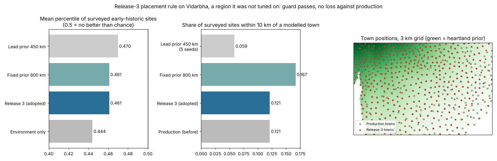

# Release-3 placement rule on Vidarbha — 14 November 2026

Plan: `calibration/vidarbha_release3_20261114/plan.json` (committed 3af474e0 before any output).
This is an **exposed-region check, not a blind test**: Vidarbha was used in November 2026 to reject the
450 km lead prior, so its numbers were seen before. The question is narrow: does the adopted release-3
rule (production tiling + exp(-D/800 km) heartland prior on score and catchment density, count held by
bisection on seat people) do worse than production on surveyed early-historic sites in a region it was
not tuned on?

## Result: guard PASSES

| Primary cohort (EH-S yes, central offset, 3 km grid) | Value |
|---|---|
| Mean percentile, environment only | 0.444 |
| Mean percentile, release 3 (= fixed 800 km prior field) | 0.461 |
| Mean percentile, lead 450 km prior | 0.470 |
| 10 km capture, production | 0.121 |
| 10 km capture, release 3 | 0.121 |
| 10 km capture, fixed prior seed 1 | 0.167 |
| 10 km capture, lead 450 km (5-seed mean) | 0.059 |

Guard: rank delta +0.017 (needs ≥ −0.05), capture delta 0.000 (needs ≥ −0.10), support 53 units in
≥2 zones (needs ≥30), count/eligibility/uniqueness constraints pass. Natural count 419 towns at 3 km is
unchanged; release 3 moves 218/419 towns (201/375 at 9 km) yet captures are identical to production in every
cohort and offset at 3 km; at 9 km one zone (Chamak) drops 0.1 → 0.0.

## What this does and does not say

- Release 3 does no harm outside its calibration region. It also adds nothing measurable on capture here;
  the prior's range on Vidarbha land is only 0.037–0.431 and smooth, so it reshuffles towns locally.
- Every percentile is below 0.5, but with ~53 site cells the standard error of a mean percentile is about
  0.29/sqrt(53) ≈ 0.04, so 0.444 is ~1.4 SE below chance: **not distinguishable from chance**, in either direction.
  A post-hoc component breakdown (exploratory, not declared; EH-S yes, central, 3 km / 9 km) found no single
  driver: smoothed density 0.445/0.459, flatness 0.443/0.441, river proximity 0.51/0.46, road 0.50/0.50,
  herder share 0.56/0.59, heartland prior 0.59/0.52. Vidarbha cannot calibrate the environmental score; it
  can only confirm that release 3 does no harm.
- Archived production and fixed-prior captures were reproduced exactly on rebuilt inputs (input drift: none).

## Reproduction

- Producer: `scripts/vidarbha_release3.py` → `output/vidarbha_release3_20261114/{results.json, model.npz}`.
- Reviewer: `scripts/review_vidarbha_release3.py` (pyproj projection, raw zip join of 134 settlements,
  dense dot-product matching, 4,536 scalar percentile/capture checks, guard rebuilt, spacing of all 794
  release-3 towns rebuilt from library constants). Fresh replay byte-identical. Status: passed.
- Survey raw files stay in ignored `data/cache/vidarbha_survey_2016/` (not redistributed).
