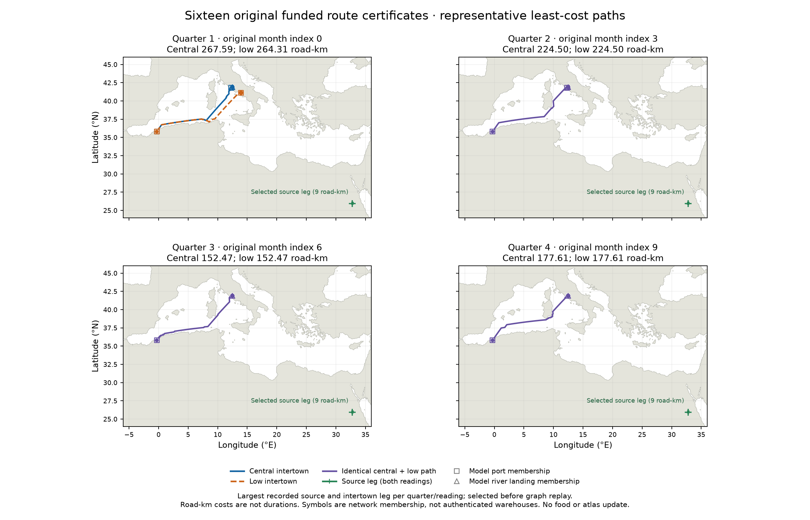

# Original route recovery before warehouse attachment — 17 November 2026

Sixteen selected original route records now have directed node/edge certificates.
All four rebuilt legacy snapshots reproduce the archived source owners and
distances exactly in both readings; the eight selected intertown costs also
match exactly at the archived dtype. No warehouse has been attached and no food
scenario, population change or atlas release was run.

This is an inspection map of an existing development network. Symbols show
membership in the original model's port/river-landing lists, not authenticated
warehouse buildings or historical access rights. The underlying coastline is
the captured window land mask. The green source leg is only one grid cell long.

## Selection and exact restoration

The [frozen declaration](../calibration/urban_diagnosis_20261117/warehouse_route_provenance_controls.json)
preceded all recovery. The
[16 selections](../output/urban_warehouse_routes_20261117/selection.json)
were committed as `cd604ca5e` before any graph call: one largest recorded positive
source departure and one largest positive intertown sent quantity per
quarter/reading, summed over that quarter, with physical-grid-ID ties. No group
was empty and no route was substituted after inspection. An initial selector
was interrupted before emitting its selection because it repeatedly decompressed
the same cost array inside a loop; the completed selector loads it once. The
incident receipt is retained. No graph or food call occurred in that attempt.

Restoration uses captured weather, winds, elevation, land, rivers and density;
the exact `E.grid` metadata and `E.window` biome expression; the archived Roman
road mask; and the original strait/sea/static/seasonal graph adapters. It makes
no weather-reader, fallback-wind or raw-city-table call. Original control source
hashes were checked first. All graph-driving inputs and city-node ordering are
identical across central/low, so four graphs serve both readings. The original
179 model ports and 206 river landings are reproduced. The
[restoration receipt](../output/urban_warehouse_routes_20261117/restoration.json)
pins input arrays and the completed world.

Recovery invokes the original `T.cost_network` with its unchanged
`C.Network` constructor; runtime capture only retains constructor records.
COO-to-CSR duplicate summation is preserved. No alternative-selecting freight
connector replaces this graph. Source paths use the original reversed directed
multi-city query, then follow predecessors from origin toward its owner.
Selected intertown queries run forward from their original sender. There is
no new full all-pairs table.

## What the selected paths show

All eight largest selected source legs share the same physical origin/destination:
grid IDs 215876 → 215276 in the Nile region, a single 9 road-km edge. Their
retained fraction is the existing 96.67% assumption. This result describes
the largest funded source leg, not all source supply or a warehouse location.

The largest selected intertown sender is grid ID 141127, in western North
Africa. Central destinations are grid ID 105258 in central Italy. Low's first
quarter destination is 111271; its other quarters share the central path.
The 16 records contain six distinct node chains, including the shared source
chain. They are deterministic representatives under the current Dijkstra
implementation, not proof of an unrecorded unique original path.

| Original month index | Central intertown cost | Low intertown cost | Central retained fraction |
|---|---:|---:|---:|
| 0 | 267.59 road-km | 264.31 road-km | 0.89% |
| 3 | 224.50 road-km | 224.50 road-km | 16.85% |
| 6 | 152.47 road-km | 152.47 road-km | 43.53% |
| 9 | 177.61 road-km | 177.61 road-km | 34.22% |

These fractions come from the original whole-leg `max(0,1-cost/270)` rule,
not newly estimated physical spoilage. Large sent quantities need not mean
large delivered quantities. The selections do not represent a new food fit.

The paths intersect three model port IDs (105856, 111271, 141127) and three
river-landing IDs (105258, 105856, 215276). Membership is retained separately
from actual harbour/river-transfer edge records. Simply passing through a
member cell does not establish boarding, storage or building identity.

## Independent checks and limits

The [independent review](../output/urban_warehouse_routes_20261117/review.json)
re-ranks the original observations, independently assembles each CSR from the
captured raw constructor records, verifies archived full source owners/distances,
and checks all 16 endpoint directions, predecessor links, auxiliary-to-physical
node identities and directed cost sums. It checks **1,148 edge occurrences**;
the maximum absolute path-cost sum discrepancy is **1.14 × 10⁻¹³ road-km**,
within the existing path tolerance (`rtol=1e-10`, `atol=1e-8`). All eight selected
intertown costs are exact after their original float32 cast.

No selected edge contains summed parallel records. That is a statement about
these 16 certificates, not evidence that the whole Roman graph lacks duplicates
or that alternative graph semantics would leave every route unchanged.
Constructor-group labels retain provenance; `land` includes the inherited
foot/ferry/track generator and is not a uniquely measured physical mode.
Physical durations remain unknown. A representative cost path does not
identify a historical warehouse, capacity, right or handling workforce.

Counts: producer **four canonical graph rebuilds/eight Dijkstra calls**;
reviewer **zero canonical graph rebuilds/zero Dijkstra calls**, plus four
independent CSR assemblies from saved raw records. Both use **zero food/stock
solves**. All 1103 protected identities remain exact. The
[qualification](../output/urban_warehouse_routes_20261117/qualification.json)
pins sources and artifacts. Raw CSR/predecessor caches total about 130 MB and
remain local/ignored; compact route certificates and this figure are tracked.
No climate model, reserved pool or site-survey workbook was opened.

## Next: preserve grain and time through zero-hold events

The [next declaration](../calibration/urban_diagnosis_20261117/warehouse_no_hold_contract.json)
closes the remaining loss/timing trap before real storage: represent one funded
whole leg once, preserve its original delivered grain and arrival bin, and
prevent intermediate events from independently multiplying retention or adding
an automatic transport bin. Manufactured conservation/timing controls come
first, then exactly two accounting-only reductions of existing baseline
arrivals, without solving inventories. Positive hold, physical warehouse
assignment, one capacity across roles, rights and complete work remain later
gates. Climate remains deferred.

Reproduce in an empty isolated OUT using `scripts/select_warehouse_routes.py`,
commit the frozen selection, then `scripts/recover_warehouse_routes.py`,
`scripts/review_warehouse_routes.py`, `scripts/plot_warehouse_routes.py` and
`scripts/seal_warehouse_routes.py`. Completed producers refuse overwrite.
