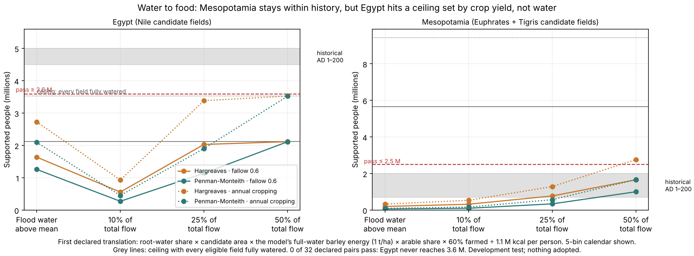

# Water to food: Egypt's ceiling is crop yield, not water

**Outcome.** A first declared translation from field root water to supported
people lets the Nile-gain and Mesopotamia-non-inflation test be scored. It
fails: 0 of 32 declared pairs pass. Mesopotamia is not inflated in 30 of 32
and often sits inside its historical 0.7–2.0 M range. Egypt never reaches the
3.6 M threshold. Even with every Nile candidate field fully watered, the
model's own crop constants cap Egypt at 2.12 M (3.53 M with annual
cropping). Water is no longer what limits Egypt; the model's rain-fed crop
constants (yield, farmed share and fallow) are. Nothing is adopted.

Protocol: [plan and amendment](../calibration/water_to_food_20261114/plan.json),
committed in `d497bc38` before scoring. The amendment corrects a slip in the
written product of the barley energy constant (2,710,224 kcal/ha; formula and
inputs unchanged) before any score.



## The translation

Supported people on each candidate field = root-water share × candidate area ×
100 ha/km² × the model's fully watered barley energy (1.0 t/ha × 0.87 edible ×
3,540 kcal/kg × 0.88 after seed = 2,710,224 kcal/ha) × arable share × 60% farmed
× sown share ÷ 1.1 M kcal per person. Sown share 0.6 (the model's fallow for
single-cropped land) and 1.0 (annual cropping renewed by flood or canal water).
Root-water share standing in for the water-limited share of a full crop is a
linear assumption, stated, not fitted.

## Results (5-bin calendar; the 4-bin calendar is similar)

| Source rule | Egypt, fallow 0.6 (H / PM) | Egypt, annual (H / PM) | Mesopotamia, fallow 0.6 (H / PM) | Mesopotamia, annual (H / PM) |
|---|---|---|---|---|
| Flood water above mean | 1.64 / 1.26 M | 2.73 / 2.10 M | 0.20 / 0.06 M | 0.33 / 0.10 M |
| 10% of total flow | 0.56 / 0.27 M | 0.93 / 0.45 M | 0.32 / 0.10 M | 0.53 / 0.17 M |
| 25% of total flow | 2.03 / 1.14 M | 3.39 / 1.90 M | 0.77 / 0.34 M | 1.29 / 0.57 M |
| 50% of total flow | 2.12 / 2.11 M | 3.53 / 3.52 M | 1.66 / 1.00 M | 2.76 / 1.67 M |
| **Ceiling (all fields fully watered)** | 2.12 M | 3.53 M | 5.66 M | 9.43 M |

Pass rule: Egypt ≥ 3.6 M (0.8 × 4.5 M) and Mesopotamia ≤ 2.5 M (1.25 × 2.0 M) on
the same settings. Nile gain: 0 of 32. Mesopotamian non-inflation:
30 of 32 (the exceptions are half the flow with annual cropping under
Hargreaves). Both: 0.

## What binds Egypt

With 24,497 km² of crop-eligible Nile candidate land, reaching 4.5 M people
needs about 184 people per km². At 1 t/ha, 60% of land farmed and full water,
the model supplies about 87 with fallow and 144 with annual cropping. Three
global constants multiply together here, and each is set for rain-fed land:

- **Yield (1.0 t/ha low-input).** Papyri point higher on good Egyptian land:
  public land was taxed at about 8.3 artabas per aroura in the Oxyrhynchite nome
  (Bagnall and Worp), and some second-century wheat land paid rents of up to 15
  artabas per aroura (Rowlandson). With an artaba of wheat at roughly 30 kg and
  an aroura of 0.2756 ha, a 15-artaba rent alone is about 1.6 t/ha. No typical
  yield was established in this search.
- **Farmed share (60%).** Set for land shared with pasture, woodland and
  villages; the Nile floodplain was mostly fields.
- **Fallow (0.6).** Basin land renewed by the flood was cropped every year.

Any of these could close the gap, so none should be picked by fitting Egypt.
The next step belongs to the crop model: a declared rule for irrigated
floodplain land (yield, farmed share and cropping frequency), tested on regions
other than Egypt before it is used here.

## Checks

Independent review with an exact Fraction constant, per-field loops over all
64 base-flow runs × 2 sown values and the pass rule re-applied; largest
relative difference 2.0e-15. A fresh run reproduces all three files byte
for byte.

## Limits

Candidate fields only approximate the historical region outlines; rain-fed land
outside them is ignored (negligible in both deserts). The linear water-to-yield
link and one crop (barley) are simplifications. Both regions and their
historical figures were already exposed; no held-out region is qualified.

## Sources consulted for the yield bounds

- [Theadelphia and village land, British Academy](https://www.thebritishacademy.ac.uk/documents/3878/96p159.pdf)
- [Rowlandson on rents, British Academy](https://www.thebritishacademy.ac.uk/documents/3877/96p139.pdf)
- [Bagnall and Frier, *The Demography of Roman Egypt*, review](https://www.cambridge.org/core/journals/journal-of-roman-archaeology/article/abs/demography-of-roman-egypt-roger-s-bagnall-and-bruce-w-frier-the-demography-of-roman-egypt-cambridge-studies-in-population-economy-and-society-in-past-time-23-cambridge-university-press1994-pp-xviii-354-figs-tables-isbn-0521461235-4995/E548DE5B3E20F67C68A7D97045784D73)

The tax figure (Bagnall and Worp) and rent figure (Rowlandson) were read from search summaries of these documents, not checked against the originals.

## Reproduce

```sh
.venv/bin/python -I scripts/water_to_food.py
.venv/bin/python -I scripts/water_to_food.py --out output/water_to_food_20261114/fresh
.venv/bin/python -I scripts/review_water_to_food.py
```
