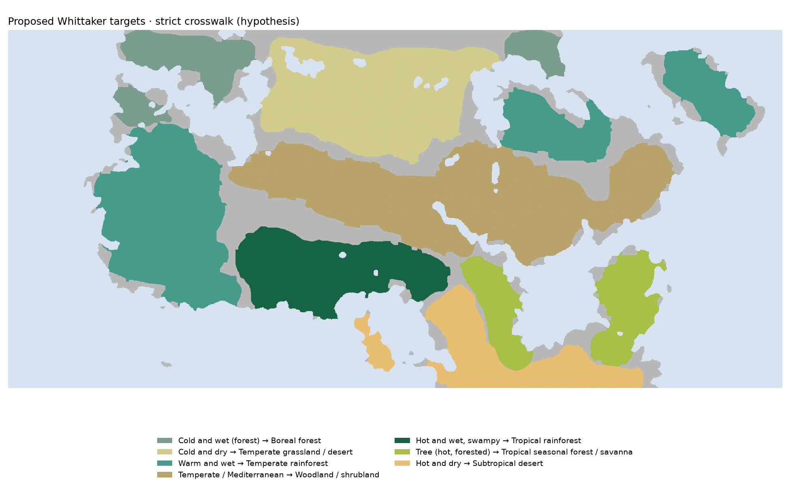
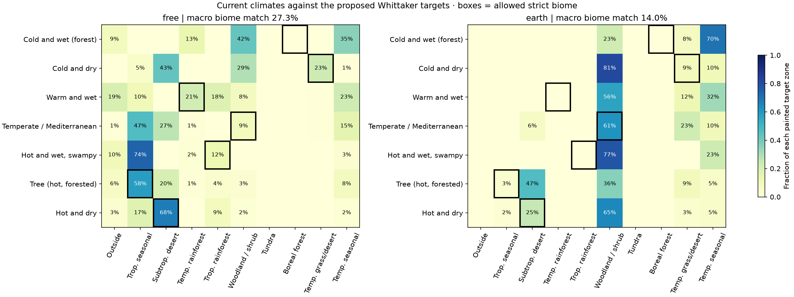
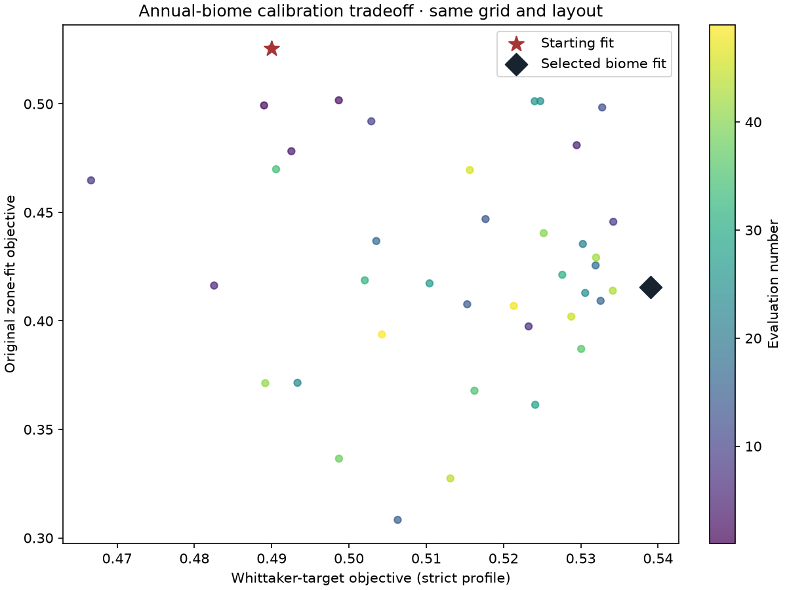
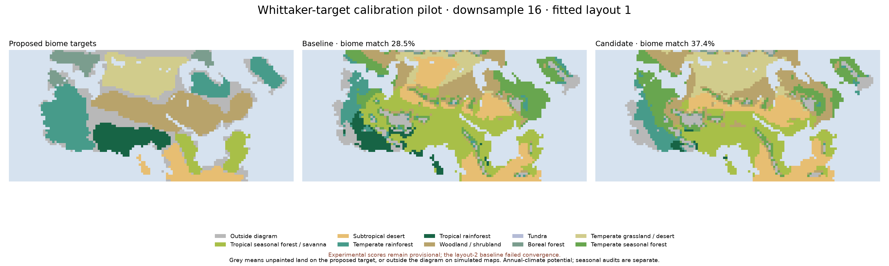

# Calibrating painted target zones through Whittaker biomes

This is a separate experiment with a different interpretation of the painted map. It adds a canonical annual-temperature/annual-rainfall target to calibration, but the translation from the map's words to biome envelopes is a hypothesis. It does not change the existing seasonal `zonefit` objective or the active atlases.

## Proposed crosswalk

| Painted target | Strict profile | Broader sensitivity profile |
|---|---|---|
| Cold and wet (forest) | Boreal forest | Boreal, temperate rainforest or temperate seasonal forest |
| Cold and dry | Temperate grassland / desert | Same |
| Warm and wet | Temperate rainforest | Temperate rainforest or temperate seasonal forest |
| Temperate / Mediterranean | Woodland / shrubland | Same |
| Hot and wet, swampy | Tropical rainforest | Tropical rainforest or tropical seasonal forest / savanna |
| Tree (hot, forested) | Tropical seasonal forest / savanna | Tropical seasonal forest / savanna or temperate seasonal forest |
| Hot and dry | Subtropical desert | Same |



The strict profile assigns one distinct biome to each painted target. It leaves tundra and temperate seasonal forest unassigned. That is deliberately restrictive, not a unique translation supported by the map. In particular, a cold winter need not imply a boreal annual climate. Neither existing atlas currently places an appreciable fraction of the painted cold-wet forest in the boreal envelope. The free fit places much of it in temperate rainforest and temperate seasonal forest instead.

The broad profile admits these ambiguous forests, but overlapping target sets make some painted boundaries less identifiable. Tropical seasonal forest/savanna also includes grass-dominated vegetation. Higher scores under that profile indicate looser allowed sets, not better physics.

Mediterranean summer drought and swamp drainage/flatness are not encoded by the Whittaker diagram. Annual biome agreement cannot establish either condition. Original seasonal-zone scores, per-zone recall, Mediterranean dry/Cs shares and realism diagnostics are retained alongside the experimental score.

## Objective

`data/biome_target_crosswalk.json` declares both profiles and fixed distance scales. Each painted zone receives equal weight regardless of its area. For each zone, the hard score is the fraction of its valid land cells whose published Whittaker class is allowed. The soft score is `exp(-d² / 2)`, where `d` is distance to the union of allowed climate polygons, with temperature scaled by **5°C** and precipitation by **500 mm/year**. Inside an allowed envelope, distance is zero. The objective is half the mean hard score plus half the mean soft score.

These two scales were fixed before the search; they are choices about optimization geometry, not measured ecological uncertainty. The categorical coverage is reported separately so that a gain from partial distance credit is distinguishable from actually entering the allowed biomes. Nonfinite climates receive zero credit. Ocean and unpainted cells do not contribute. Outside-envelope climates can receive partial optimization credit but keep their grey/unclassified biome label on maps.

This objective uses no seasonal, terrain or realism penalties; those are separate audits in this pilot. A hybrid objective would need to retain such constraints explicitly. The score is not numerically comparable to the original `zonefit` score.

## Baseline diagnosis

Saved publication-grid climate fields (downsample 8, 25 steps) give:

| Existing fit | Strict objective | Strict categorical match, mean over zones | Broad objective |
|---|---:|---:|---:|
| Free fit | 0.477971 | 27.3% | 0.700637 |
| Earth fit, r29 | 0.353414 | 14.0% | 0.575423 |

These are post-hoc interpretations of the same climate fields, not new model runs or independent validation. Earth-fit fields here are its three-layout mean before classification. The pilot below fits individual layout 1. Each result must therefore be compared with its own baseline on identical grids and layouts.


A concrete mismatch: 61.2% of the Earth fit's painted Mediterranean land already falls in woodland/shrubland, while only 21.9% has Köppen Cs seasonality. Conversely, a genuinely dry-summer forest can fall outside the woodland/shrubland envelope. A Mediterranean-to-shrubland translation therefore adds an annual-climate interpretation and still needs a summer-drought constraint.



## Bounded pilot

The pilot starts from the current free-fit parameters. It searches the same `e3b5` world/physics space in the existing reversed-spin basin: **49 candidates including the baseline, population 8, sigma 0.025, seed 221022, downsample 32, layout 1, 25 seasonal steps, racing disabled**. Failed temperature/wind or moisture solves are rejected; saved numerical requirements are preserved. The initial candidate remains eligible.

The winner is compared against the starting parameters at **downsample 16 on layouts 1 and 2**. Layout 2 is absent from this pilot's optimization, but it is an existing development seed rather than an independent validation sample. This is an experimental local search, not a global optimum, an Earth-physics recalibration, or a native-grid atlas replacement. The broader profile is scored for sensitivity; it is not separately optimized in this pilot.

Commands:

```sh
.venv/bin/python -I scripts/calibrate_cli.py \
  --start calibration/autonomous_20261021/free_polish/best_params.json \
  --physics e3b5 --objective whittaker --downsample 32 --saved-numerics \
  --evals 49 --popsize 8 --sigma 0.025 --seed 221022 --workers 2 \
  --fix '{"retrograde":0.75}' --race 0 --out calibration/whittaker_20261022/free
.venv/bin/python -I scripts/whittaker_target_experiment.py review
```

`--objective whittaker-broad` selects the alternative profile. Use a new output directory if changing the crosswalk or objective; do not mix optimizer checkpoints across hypotheses.

## Search result

The 49 evaluations completed: **9** failed numerical convergence and were rejected; **40** produced scores. The best experimental candidate was evaluation **39**.

| Calibration grid, layout 1 | Starting fit | Best Whittaker fit |
|---|---:|---:|
| Strict biome objective | 0.489984 | 0.539027 |
| Categorical biome match, mean over zones | 28.09% | 37.03% |
| Original zone-fit objective | 0.525589 | 0.415589 |
| Original exact cell agreement | 60.05% | 52.46% |
| Painted Mediterranean classified dry B | 8.85% | 14.06% |
| Painted Mediterranean classified Cs | 80.21% | 71.88% |

Only the starting candidate passes all five existing zone-preservation limits when applied as a post-hoc audit on this grid: overall strict agreement loss ≤1 percentage point; cold-dry recall loss ≤2 points; hot-dry recall loss ≤3 points; Mediterranean Cs loss ≤2 points; Mediterranean dry share ≤max(starting share, 5%). The best biome candidate fails overall agreement and both Mediterranean limits. These gates were audited separately and did not enter the experimental objective.

This is a real change of target, rather than an independent test of physical correctness. Higher biome agreement is useful if the proposed meanings are intended, while reduced Mediterranean seasonality contradicts a property still named on the map.



## Finer-grid review and interpretation

On **downsample 16, layout 1**, both runs completed:

| Same finer grid and layout | Starting fit | Biome-target candidate |
|---|---:|---:|
| Strict biome objective | 0.487677 | 0.536562 |
| Mean categorical biome match | 28.50% | 37.43% |
| Broader-profile objective (sensitivity only) | 0.701965 | 0.758181 |
| Original zone-fit objective | 0.542298 | 0.415377 |
| Original exact cell agreement | 60.61% | 52.93% |
| Mediterranean dry B share | 10.90% | 15.82% |
| Mediterranean Cs share | 77.53% | 71.01% |
| Land rainfall median, mm/year | 1040 | 805 |
| Land rainfall 95th percentile, mm/year | 3470 | 3118 |

The higher biome score survives refinement. There are annual-climate benefits: rainfall extremes decrease, and the broad-profile score also increases. However, the gain is concentrated in the cold-dry region, while some targets lose coverage. Equal zone weights still allow one region to be sacrificed for another:

| Painted zone | Strict biome match before | After |
|---|---:|---:|
| Cold and wet (forest) | 0.00% | 0.00% |
| Cold and dry | 29.52% | 87.35% |
| Warm and wet | 20.45% | 25.57% |
| Temperate / Mediterranean | 8.24% | 18.75% |
| Hot and wet, swampy | 14.20% | 2.52% |
| Tree (hot, forested) | 60.68% | 53.85% |
| Hot and dry | 66.40% | 74.00% |



The candidate fails the same overall-agreement and Mediterranean guards on this finer grid. A tropical seasonal wetland can legitimately fall outside tropical rainforest, so the swamp result also exposes the restrictive crosswalk rather than proving that real wetlands disappeared. Its broader allowed-biome coverage stays near 82%. Hydrology and seasonal behavior must be judged separately.

**Layout 2 is not a successful paired comparison.** The starting fit fails temperature/wind convergence at day 80.3 after 1,344 iterations over three stages, with a full update of 0.499664°C against the 0.05°C tolerance. Its score is absent, not zero, and is not dropped into a successful-layout average. The candidate completes that layout (strict objective 0.505805, macro biome match 33.84%). This does not establish improvement over the failed reference or independent robustness. Three of the four planned finer-grid runs complete; the summary records partial coverage.

## Recommendation and disposition

Whittaker envelopes are useful as an annual temperature/rainfall foundation. The mapping should admit the biome ambiguity of cold-winter temperate forest, Mediterranean forest and seasonal wetlands. Add explicit constraints for coldest-month temperature, Mediterranean summer drought, swamp heat/drainage and realism, plus protection against sacrificing an entire target zone. Those constraints carry information that the two-axis biome diagram cannot supply.

The new objective and selected parameters remain available for further experiments. The candidate is **not promoted** to either active atlas: the narrow interpretation changes important target meanings, the seasonal guards fail, the second-layout reference fails numerically, and no downsample-8 publication comparison has been run for it. This experiment supports a combined biome/seasonal approach; it does not establish that replacing the existing rules improves physical accuracy. The broad profile was evaluated, but an optimized hybrid or broad-profile search has not been run.

## Evidence and checks

The score module is `rotclimate/biome_targets.py`. The crosswalk and its full scoring specification are snapshotted in `calibration/whittaker_20261022/free/objective.json`. Run bounds and source hashes are in `output/whittaker_targets_20261022/protocol.json`; structured evaluations, failure messages, selected parameters, paired finer-grid results and cached climate fields are retained separately.

Nineteen focused tests passed: representative source climates map correctly, extreme outside climates do not get relabeled, partial credit decreases for excessive rainfall, zone balancing resists area imbalance, invalid data do not vanish, ocean/unpainted cells are excluded, broader sets do not reduce coverage, and layout scores average without voting on biome IDs. Existing calibrator budget/restart preservation tests and biome classifier tests also pass.

The previous production-grid builds emitted linear-solver iteration-limit warnings, so their published climate scores remain provisional. This experiment does not resolve that numerical issue. Its own failed runs and warnings are recorded rather than converted into successful scores.
