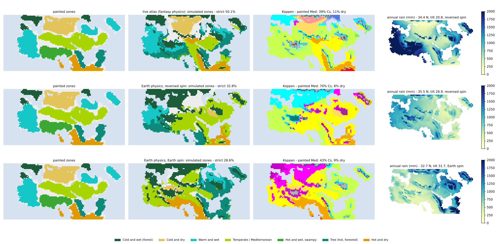

# Earth mode: can the production model simulate real climates?

16 October 2026. Work after the 13–16 October handoff, with the goal the user
set: make the simulator reproduce real climates — California and Iberia first,
then real-world equivalents of every painted zone.

## 1. Review of the handoff (what was kept, what was not)

**Kept in full — production numerics (V9).** Converged moisture iterations with
a local equation check (`moisture_residual_tol`), optional strict linear solves,
bounded temperature retries, the `exponential` transport option, the moisture
budget diagnostics, `eddy_seasonality` and the `zonefit` objective. These are
sound and well tested (604 tests passed at the merge, 609 now). One finding
here strengthens them: on real geography the old fixed two damped Picard
half-steps are badly unconverged — California's mean rain is 938 mm with them
and 748 mm converged. Every calibration made with the old numerics fitted that
numerical error as if it were physics.

**Kept as frozen evidence, not developed further — the V10 layered prototype.**
Its water accounting is rigorous, but its skill on the two Earth regions is
very poor: coastal winter (Oct–Mar) rain is 57–93 mm in California and 33–61 mm
in Iberia against its own references of 535 and 439 mm, and 78–97 % of the
target Mediterranean cells turn arid
([its review](../output/v10_regional_transport_review/review.md)). Its
last experiment stopped at 6/8 cases for diagnosis. The production model
already does far better on the same coasts (section 3), so the effort went
there.

**The gap the handoff left.** The production model had never been run on real
geography. Its physics constants were fitted together with the world's
unknowns (latitude, tilt, spin, terrain heights, the land beyond the map), so a
wrong constant could hide behind a wrong unknown. On Earth every unknown is
known, so the physics can be tested on its own.

## 2. Earth mode

`rotclimate/earth.py` builds the model grid from WorldClim 2.1 (5′ terrain and
1970–2000 monthly normals) on an azimuthal-equidistant projection around each
region (exact distances, north up), with 1,100 km of real surroundings, and
runs the unchanged production model with Earth's tilt, spin, orbit and
calendar. Observed "painted zones" come from the zone rules applied to the
observed climate, so every fantasy score has an Earth counterpart.

| Region | Stands in for | Observed Köppen (top) |
|---|---|---|
| california | Mediterranean, hot-dry, cold-dry, cold-wet mountains | Csa/Csb, BSk, BWh, Dsb |
| iberia | Mediterranean, hot-dry (Sahara edge), warm-wet (France) | Csa, BSk, BWh, Cfb |
| southeast_us | warm-wet, "tree", swamp (S Florida) | Cfa 95 % |
| levant | Mediterranean, cold-dry steppe, hot desert, cold-wet highlands | BWh, Csa, Dsb, BSk |
| central_asia | cold-dry | BWk 47 %, BSk 30 % |
| east_china | warm-wet, "tree" (monsoon) | Cfa 61 %, Cwa 27 % |
| chile, cape, sw_australia (held out) | southern Mediterranean coasts | Csb, BSk, BWh, Csa |

Southern regions are run as their north–south mirror image with the months
shifted by half a year (the reflection and the opposite Coriolis turning cancel,
so it is the same physics on a northern map; perihelion moves with them).

Scores (`earth.compare`): the **climate distance** d (RMS monthly temperature
error / 2.5 °C + RMS monthly √rain error / 2, averaged over land cells: 0 =
identical), temperature bias, rain totals and seasonality, coastal winter rain,
Köppen agreement, the share of observed Cs kept as Cs or lost to arid, zone
agreement, and climographs for 4–8 well-known cities per region.

## 3. Results so far

Climate distance d on each region (56 km cells; lower is better). The two
reference rows are built from the observations themselves: every land cell
given its region's mean climate (no skill), and every cell given the mean
observed climate of its 2° latitude band corrected to its height (a perfect
zonal model with no coast-to-interior structure).

| Physics | CA | Iberia | SE US | Levant | C Asia | E China | Chile* | Cape* | SW Aus* | mean |
|---|---|---|---|---|---|---|---|---|---|---|
| reference: region mean | 2.91 | 2.74 | 1.69 | 3.26 | 2.79 | 1.95 | 3.14 | 1.23 | 1.36 | 2.34 |
| reference: latitude band + height | 1.78 | 1.12 | 1.01 | 1.30 | 1.27 | 1.26 | 2.22 | 1.07 | 0.79 | 1.31 |
| fantasy-fitted (live atlas anchor) | 4.13 | 3.43 | 2.75 | 3.59 | 3.09 | 3.85 | 4.55 | 4.11 | 3.25 | 3.64 |
| r1b: fitted on CA + Iberia only | 1.78 | 1.74 | 4.46 | 1.97 | 2.46 | 6.21 | 3.12 | 2.15 | 2.65 | 2.95 |
| r2: six regions, free circulation | 2.56 | 2.66 | 1.79 | 2.23 | 1.93 | 3.21 | 2.85 | 2.60 | 1.65 | 2.39 |
| **r4: six regions, Earth circulation, all e1 physics** | **1.86** | 2.19 | 1.76 | **1.83** | **1.48** | 3.50 | 3.52 | 2.01 | 1.85 | **2.22** |

\* held out of every fit.

- The **fantasy-fitted physics** is worse than "the regional mean everywhere"
  in every region but the south-east US: ~2× too wet and 3–4 °C too cold in
  the Mediterranean regions, almost no Cs kept (0–6 %).
- **Fitting California and Iberia alone** fixes them (Köppen 39–52 %, Cs kept
  33–45 %) and transfers to the held-out southern Mediterranean coasts, but
  turns the humid south-east US and east China 5–7 °C too hot and too dry.
- **Fitting all six regions with the circulation free** finds a compensating
  error: it moves the subtropical high to 37.7°N all year (Earth's: ~30–33°N,
  migrating ~5° with the seasons). California and Iberia then sit under the
  high all winter with weak easterly winds instead of the westerlies, so no
  mild ocean air reaches the west coasts, and the Mediterranean regions are
  sacrificed (Köppen 14–17 %) for the humid ones (south-east US 96 %).

On Earth the circulation is observed, so later fits bound it to Earth's range
(high 28–34°N shifting 3–8°, westerlies 4–12 m/s, trades 4–9 m/s, ITCZ 2–8°N
± 6–14°): the climate must come out right for the right reasons. With those
bounds (r3) the Mediterranean regions keep 78–90 % of their Cs.

**The current Earth fit (r4,** `calibration/earth/earth_e1_r4.json`**: 46
physics constants, 960 evaluations, ~2 h on four cores)** brings the training
mean from 3.47 (fantasy physics) to 2.10:

| Region | d (refs) | T bias | Rain sim/obs | Köppen exact | Cs kept / → arid |
|---|---|---|---|---|---|
| California | 1.86 (2.91 / 1.78) | −1.2 °C | 468 / 392 mm | 29 % | 92 % / 0 % |
| Iberia | 2.19 (2.74 / 1.12) | −1.7 °C | 499 / 392 mm | 22 % | 73 % / 4 % |
| SE US | 1.76 (1.69 / 1.01) | +0.4 °C | 1045 / 1229 mm | 97 % | – |
| Levant | 1.83 (3.26 / 1.30) | −0.8 °C | 324 / 394 mm | 42 % | 50 % / 26 % |
| Central Asia | 1.48 (2.79 / 1.27) | +0.2 °C | 233 / 228 mm | 34 % | – (cold-dry zone 88 %) |
| East China | 3.50 (1.95 / 1.26) | +3.2 °C | 912 / 1281 mm | 62 % | – |
| Chile* | 3.52 (3.14 / 2.22) | +4.2 °C | 485 / 489 mm | 8 % | 100 % / 0 % |
| Cape* | 2.01 (1.23 / 1.07) | +1.0 °C | 595 / 324 mm | 3 % | 100 % / 0 % |
| SW Australia* | 1.85 (1.36 / 0.79) | +1.4 °C | 438 / 358 mm | 22 % | 77 % / 23 % |

What this means: the model now produces Mediterranean climates where Earth
has them — wet winters and dry summers on the west coasts, with almost no Cs
turned into desert (the V10 prototype turned 78–97 % arid) — and humid
subtropics on the east coasts, steppe and desert in the interior, from the
same physics. It does not yet beat the "perfect zonal model" reference in
most regions: the coast-to-interior detail is right in kind but not yet in
amount (exact Köppen agreement is 22–42 % in the Mediterranean regions, with
most misses between neighbouring classes such as Csa/Csb or BSk/BWk).

Known limits, documented rather than tuned around:

- **East China** stays 3–6 °C too warm from autumn to spring. Its winters come
  from Siberian air (the East Asian winter monsoon), Earth's most extreme
  continental anomaly; the model's land temperature is the latitude mean
  (11 °C in January at 30°N, against 4 °C observed in Wuhan). A test coupling
  coastal seas to the overlying air did not help and was removed.
- **Chile's coast** is 8 °C too warm in its summer: a strip one or two 56 km
  cells wide against the Andes, whose cold marine layer is below the model's
  resolution, in a hemisphere that is more oceanic than the mirrored northern
  land temperature assumes. Weakening the storm-eddy heat mixing (to stop
  Argentine air leaking over the Andes) did not help.
- **Holdout transfer is mixed:** all three southern Mediterranean regions keep
  their Cs (77–100 %, none turned arid), but their overall climate distance is
  worse than with the earlier unconstrained fit, mostly from summer heat.

## 4. What calibration could not fix: new physics (e1)

City climographs and monthly bias profiles showed structural errors that no
parameter setting removed:

1. **No real summer drought.** Rain-rate suppression under the subtropical
   highs cannot dry a supply-limited column: the water piles up until it rains
   anyway (San Francisco 45 mm in August, observed ~1 mm).
2. **Rainy season 1–1½ months early** (San Francisco 85 mm in September,
   observed ~5 mm): the circulation was fixed to lag the sun by 30 days.
3. **Spring on land a month early** (April in east China 8–9 °C too warm,
   Memphis +6 °C, summer peaking in June).
4. **No west-coast/east-coast asymmetry.** Every land cell relaxes to the same
   latitude-mean "continental" temperature however much land its air has
   crossed: west coasts stayed 2–4 °C too cold, east coasts 1–4 °C too warm.
5. **Cold seas all year or never.** The fits pinned the global sea-surface
   offset at −4 °C plus 5.5 °C cold currents: right for the summer upwelling off
   California and Iberia, far too cold for their winter coasts.
6. **Elevated deserts ~6 °C too cool in summer** (Reno, Las Vegas, the
   Meseta) at the fixed 6 K/km lapse rate; WorldClim's own along-terrain lapse
   rates are 3–5.5 K/km.

New parameters, each defaulting to the old behaviour (round 19's strict fit
gives bit-identical temperature, rain and water fields with the handoff's
`model.py`; only the source fingerprints change):

| Parameter | Physics |
|---|---|
| `subsidence_drying` | Under the highs, dry air sinking from aloft replaces moist low-level air: the column dries without raining (Pierrehumbert's advection–condensation picture). |
| `sverdrup` | Sverdrup balance βv = f ∂w/∂z: low-level flow toward the pole rises, toward the equator sinks (dry summers on west coasts, monsoon rain on east coasts; Rodwell & Hoskins 2001, Seager et al. 2019). |
| `circulation_lag_days` | How far the highs, storm track and ITCZ lag the sun (was a fixed 30 days). |
| `subsidence_width` | Latitude width of the highs' sinking (was a fixed 6°). |
| `storm_seasonality` | Summer weakening of the storm track (was a fixed 0.3). |
| `land_heat_capacity` | Heat capacity of the energy-balance land column: how far land seasons lag the sun. |
| `continentality` | Land fraction carried along the model's own winds (4-day memory, one extra linear solve per step) scales the land seasons: sea air milder, continental air harsher. With Earth-like westerlies it reads 0.40 over California and 0.61 over Iberia in January, 0.95–0.99 over the south-east US and east China. |
| `upwelling` | Wind along a coast drives surface water 90° to its right (Ekman; left with reversed spin); where that is offshore, cold water wells up. From the coastline and the model's winds: +1.8 to +2.3 m/s offshore transport off California, Iberia and Chile in July, none in January. |
| `lapse_rate` (Earth fit only) | Fitted on Earth where heights are known; held fixed on the map, where it would trade off against the unknown terrain heights. |

All of them are computed from the model's own winds, temperatures and
coastline, never from geographic labels, so they apply unchanged to the
fantasy map with either spin and any orientation.

## 5. On the fantasy map

Physics fitted on California and Iberia alone, dropped onto the live atlas's
world unchanged, dried the map out (strict agreement 12.7 %, painted
Mediterranean 88 % dry; the anchor scores 50.2 % and 11.2 % at the same
downsample-16 screening resolution): the anchor's world genes (reversed spin,
34°N, 21° tilt) were fitted together with the fantasy physics. So the world's
unknowns are refitted with the Earth physics held fixed, once per spin
direction (181 evaluations each, downsample 16, `zonefit`;
`calibration/earth/world_e1_retro.json`, `world_e1_pro.json`):

| Same screening resolution (downsample 16) | zonefit | strict | Med recall | Med Cs / dry | cold-dry | hot-dry | swamp | tree | cold-wet | warm-wet |
|---|---|---|---|---|---|---|---|---|---|---|
| live atlas (fantasy physics, reversed spin) | 0.411 | 50.1 % | 36 % | 39 % / 11 % | 72 % | 61 % | 11 % | 52 % | 78 % | 55 % |
| Earth physics, reversed spin (35.5°N, tilt 28.9°) | 0.186 | 32.8 % | **66 %** | **70 % / 8 %** | 0 % | 20 % | 0 % | 1 % | 86 % | 34 % |
| Earth physics, Earth spin (32.7°N, tilt 31.7°, north 29° W of up) | 0.209 | 28.6 % | 33 % | 43 % / 9 % | 1 % | 56 % | 0 % | 81 % | 79 % | 14 % |

With physics that works on Earth and reversed spin, the painted Mediterranean
band comes out *better* than in the live atlas — two thirds of it labelled
Mediterranean, 70 % Cs and only 8 % dry, the user's main concern — but the
painted cold-dry north turns into cold forest (500–1,000 mm of rain where
cold-dry needs a few hundred), the swamp and "tree" zones vanish and the
hot-dry south is too wet. With Earth's spin the west coast becomes
Mediterranean instead of the painted warm-wet, which is why the map favours
reversed spin under either physics. The live atlas's higher overall agreement
relies partly on physics that is wrong on Earth (section 3).

A joint fit (`scripts/joint_calibrate.py`) then fitted physics and world
together to the map, the physics penalised as soon as its mean Earth climate
distance rose above 2.25: best zonefit 0.202 at Earth distance 2.23
(`calibration/earth/joint_e1_retro.json`, the Earth-physics atlas). A free fit
of the same physics with no Earth constraint reached 0.458
(`free_e2new_retro.json`, the free-fit atlas).

### 5.1 What makes the painted cold-dry north dry?

`scripts/physics_attribution.py` swaps one group of the free fit's physics
constants at a time into the joint (Earth-realistic) fit, world unchanged
(downsample 16; `output/earth_on_map/attribution_joint_vs_free.json`):

| Swapped from the free fit | zonefit | strict | cold-dry | Mediterranean | hot-dry |
|---|---|---|---|---|---|
| nothing (joint fit) | 0.202 | 33.1 % | 0 % | 62 % | 18 % |
| circulation | 0.158 | 22.6 % | 0 % | 23 % | 0 % |
| temperature | 0.099 | 20.8 % | 2 % | 40 % | 26 % |
| moisture supply | 0.195 | 30.9 % | 1 % | 69 % | 22 % |
| rain (incl. e2 closure) | 0.171 | 32.5 % | 0 % | **90 %** | 38 % |
| sinking air | 0.174 | 30.1 % | 0 % | 42 % | 2 % |
| **storm eddies** | **0.219** | 32.3 % | **55 %** | 48 % | 26 % |

Only the storm-eddy group makes the cold-dry zone: the free fit mixes
moisture by eddies over a 423 km scale (the Earth fits: ~900 km) and weakens
them more in summer (seasonality 0.7 vs 0.22). A scan of the eddy settings on
the joint fit, scored on the map and on all nine Earth regions
(`scripts/eddy_scan.py`, `output/earth_on_map/eddy_scan.json`):

| eddy scale / seasonality | zonefit | strict | cold-dry | Mediterranean | Earth d (9 regions) | C Asia | SE US |
|---|---|---|---|---|---|---|---|
| 896 km / 0.22 (joint fit) | 0.201 | 33.1 % | 0 % | 62 % | 2.336 | 1.66 | 2.01 |
| 896 km / 0.70 | 0.206 | 37.4 % | 0 % | **78 %** | 2.427 | 1.74 | 2.04 |
| 750 km / 0.45 | 0.207 | 34.2 % | 1 % | 68 % | 2.389 | 1.79 | 2.09 |
| 650 km / 0.55 | 0.211 | 33.8 % | 2 % | 68 % | 2.419 | 1.88 | 2.17 |
| 550 km / 0.70 | 0.214 | 31.9 % | 7 % | 65 % | 2.459 | 1.98 | 2.29 |
| 423 km / 0.22 | 0.217 | 30.3 % | **53 %** | 40 % | 2.501 | 2.16 | 2.64 |

The cold-dry zone switches on only below ~550 km, and every step there costs
Earth realism: shorter eddy mixing starves continental interiors (Central Asia
61 mm a year against 228 observed at 423 km) and the Gulf coast. On Earth a
dry interior at 40–45° needs either a long overland fetch or mountains
upwind (Manabe & Broccoli 1990); the painted north has neither at the map's
scale, so Earth-like physics keeps it forested. Stronger summer weakening of
the eddies alone is cheaper (Earth d +0.09) and lifts the Mediterranean
match from 62 % to 78 %.

## 6. Tried and removed (no measurable effect)

- **Coastal seas following the air over them** (shallow shelf seas chilled by
  offshore continental air): East China stayed +4.1 °C; its warm winters come
  from the land temperature itself, not the coastal sea.
- **A trapped marine layer** (low coastal land pulled toward the nearest sea's
  temperature when warmer, below a 0.8–1 km inversion, fading over 50 km):
  Valparaíso's summer moved 30.2 → 29.7 °C against 19.2 observed. At 56 km
  the coastal cells' temperature is set by the storm-eddy heat mixing (fitted
  to a ~900 km scale), which averages the coast with the hot interior.
- **A crest squeeze** (air fast enough to climb a ridge, h_eff = min(h, U/N),
  saturates at the crest: Smith & Barstad's dividing streamline, to make rain
  shadows): the lee dried a little (Reno 441 → 347 mm, observed 241) but all
  high ground got wetter (Fresno 802 → 1,110 mm against 382, Tashkent 290 →
  898 against 474); the mean distance over California, Central Asia, the
  Levant and Iberia rose from 1.84 to 1.93–2.11 even with the orographic
  boost cut to a half or a quarter.
- **Seasonal land coupling** (e2, `land_coupling_insolation`) is kept as an
  option but barely moved East China (Wuhan January 10 °C vs 4 °C observed):
  the air arriving there is itself 4 °C too warm, with no Siberian High in a
  latitude-mean land temperature.

The e2 rain closure (exponential convective rain, no background ascent,
sub-cloud evaporation) is what helps: Miami 936 → 1,548 mm (observed 1,395)
in a hand test, and the free map fit chose it (no background ascent).
