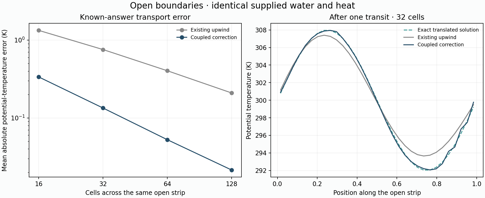

# Regional transport attempt stopped for diagnosis

**16 October 2026 result:** The user-run experiment stopped after 6/8 cases
in 54.35 minutes. Four upwind controls match exactly; all 16 completed annual
records verify. The two FCT bulk trials increase coastal winter rain but
neither settles; Iberia's reference-arid summer error also worsens. The first
FCT parcel trial fails with `Ascending parcel condensate exceeds transported
water.` No monthly physical checkpoint exists for that failed case; the second
parcel trial never starts. The atlas remains unchanged.

Do not reset the failure or retry the old command unchanged. Read the
[verified analysis](../output/v10_regional_transport_review/review.md)
and [handoff and next priorities](HANDOFF_20261016.md).
The original preparation/protocol is preserved below for provenance; its
command is not the current recommended next action.

## Original preparation: open boundaries verified

16 October 2026. The less diffusive transport candidate now supports open
boundaries in a separate module, with exact delegation to the frozen upwind
control. **133 focused checks pass.** Sixteen independent <=60-second FCT
probes on saved California/Iberia states pass, with exact upwind comparisons,
identical incoming vapor and independent external water/heat reconstruction.
No real regional year or calibration was run by the assistant.

## Original user-run command (stopped; do not repeat unchanged)

From the project directory:

```sh
caffeinate -i .venv/bin/python -u scripts/check_v10_regional_transport.py --run --hours 2
```

Expect roughly **1–2 hours**, with a two-hour invocation cap. Repeat the same
command if it stops at `budget_reached` or after an interruption; completed
cases and saved months are reused. A physical or integrity failure instead
stops at `needs_diagnosis` for inspection. Do not delete its evidence or retry
with changed physics in the same output folder.

The prepared estimate is 46–92 minutes for the four candidate climates alone,
depending on three versus six settling cycles, plus four control replays and
verification/checkpoint overhead. It extrapolates short-step timings and
saved step counts, so it is not a guaranteed finish time. The script's default
cap is 90 minutes; the command above explicitly allows two hours.

Progress appears after each saved month. Outputs go to
`output/v10_regional_transport/`; `summary.md`, `progress.json` and `state.json`
describe completed cases and the active invocation.

## The scientific question

Can preserving moist structures during transport improve coastal winter
rainfall under **the same moisture supply and circulation**, without worsening
the dry interior? The completed laboratory demonstrated that numerical mixing
can both destroy rising-cloud condensate and create false condensate at a
saturated warm/cold contact. Better transport need not make every place drier.

This fixed comparison holds the weather catalogue, dry-mass fluxes, humidity
pattern, actual incoming vapor, cloud rules, soil, relaxation and pressure/
temperature targets constant. It changes internal transport only. It is not
a parameter sweep, a new weather sample or independent regional validation.

Eight cases are declared before any real annual work:

| Stage | California | Iberia domain |
|---|---|---|
| Exact reproduction controls | Bulk and lower-interface parcel clouds, frozen upwind | Same two cloud rules |
| Transport candidates | Bulk and lower-interface parcel clouds, coupled correction | Same two cloud rules |

The Iberia domain also contains North Africa. Each control reproduces one
saved final year from its exact preceding-year state. Each candidate starts
from its corresponding settled source final state and repeats the forcing
year for 3–6 cycles, stopping at the first eligible settling point. These
cycles measure settling, not independent climate samples. Total saved work
is 16–28 annual cycles if the full protocol completes.

The primary physical comparison uses the latest cached **local-matched**
humidity with seed67/lift16/aligned forcing. No forcing table is rebuilt and
no data is downloaded. Source climates, prepared tables and the previous
laboratory evidence retain their original fingerprints.

## Boundary implementation

External faces retain the original donor-cell transfers. Incoming vapor and
theta use the same prescribed boundary concentrations; outgoing vapor and
energy use the old cell state. Their correction is zero. High-order correction
is applied only between internal cells, with one limiter for theta and vapor.

Every cell's fixed dry mass is checked against the combined internal and
external dry-air fluxes. The midpoint predictor includes the external flux,
and the local limiting bounds include actual incoming boundary states.
Corner cells receive each physical face contribution once. No artificial
reservoir cells or post-update scalar clipping are introduced.

Passive static energy and temperature reuse the same accepted internal face
coefficients to diagnose prescribed work and signed temperature changes.
External heat is recorded explicitly. The regional advance/year adapters
retain the frozen microphysics, budgets, monthly import checks and checkpoint
layout; the upwind branch calls the original functions directly.

The lower-interface parcel rule still diagnoses rain from its original donor
cell. Its dose must not exceed the vapor available after corrected transport.
The manufactured trajectories and short real-input probes pass that check.
The annual runner retains the rejection if a later trajectory violates it;
it does not clip rain or silently redefine the cloud rule.

## Manufactured and short-input evidence

An open strip carries a smooth wave through the domain. Incoming water and
heat are integrated using exact time-averaged face concentrations, common to
both methods. The full translated solution is known independently.

| Cells | Upwind theta MAE | Candidate theta MAE |
|---|---:|---:|
| 16 | 1.332554K | 0.336195K |
| 32 | 0.755622K | 0.134087K |
| 64 | 0.403586K | 0.052507K |
| 128 | 0.209218K | 0.021423K |

The candidate reduces this error by about 75–90%. Both receive identical
manufactured tracer dose, and independently computed boundary input/output
close the water and heat accounts. External faces remain first order; the
result is not a claim of globally second-order open-boundary convergence.



Tests also cover reversed flow, unequal cell masses, boundary corners,
nonnegative fields, closed-mesh compatibility, exact upwind delegation,
manufactured full-year ledgers and exact interrupted/restarted trajectories.
The case runner is exercised end to end on a tiny manufactured climate,
including real summaries, saved evidence and reuse of completed years.
Batch tests cover budgets, source/evidence changes, failure stops and read-only
handling of a completed batch.

The sixteen independent input probes use forcing dates 0/90/180/270 days and
one fixed saved state per region/cloud rule. They do not advance a seasonal
trajectory. Their maximum residuals are 2.62e-16mm water, 1.45e-8J/m² energy
and 2.08e-13°C signed temperature changes. Prepared arrays and source
identities are saved in
[the new preflight manifest](../output/v10_regional_transport_preflight/manifest.json).

Short-step costs are roughly 2.7–4.4 times the corresponding upwind step.
The two-column laboratory timings were insufficient to estimate this regional
cost; using actual input shapes before commissioning annual work avoids that
mistake. Changing cloud activity during a real year can still alter runtime.

## How to judge the result

Every completed year must pass the existing water, energy, signed thermal,
parcel/total-rain and monthly incoming-supply checks. Controls must reproduce
their saved physical fields and ledgers exactly. Candidates must be settled
and respect the existing temperature guards before interpretation.

Save and compare coastal winter rainfall, reference-arid summer cell/month
MAE, Mediterranean cells still classified arid, and the full seasonal error
groups. The small mechanism screen retains the earlier rule: reduce arid
summer MAE while losing at most 2mm coastal winter rain, with settling and
temperature guards passing. An aggregate MAE improvement alone is insufficient.
Neither this screen nor the fixed-temperature Köppen diagnostic is a fantasy
atlas promotion rule.

The fantasy atlas remains unchanged. The existing Mediterranean/cold-dry/
hot-dry protections remain in force. NOAA six-hourly downloads remain paused.
The separate question of coherent winter storm circulation is not resolved
by these transport tests.

Implementation:

- [Open transport](../experiments/v10_boundary_transport.py)
- [Frozen-cloud regional adapters](../experiments/v10_regional_transport.py)
- [Manufactured open-wave tests](../experiments/v10_boundary_lab.py)
- [Fixed user-run experiment](../scripts/check_v10_regional_transport.py)

