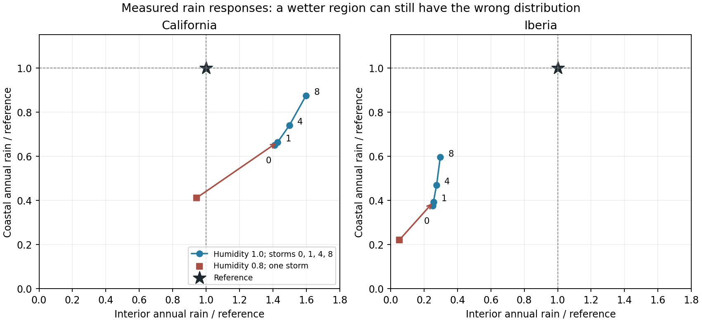

# Storm responses: test the missing spatial circulation

15 October 2026. The user completed all ten mass-projection/storm cases.
Source, manifest, inputs, case configuration, every annual field/metadata hash,
recomputed settling and final summaries were verified. All cases settle: 35
repeated cycles took 32.37 minutes. Six pass the declared broad screens, but
none establishes transferable rainfall skill across both regions. The atlas
remains unchanged.

## What improved, and what did not

The pure airflow change substantially reduces dry gaps. California minimum-wet
coverage improves from 52.0% to 80.7%, Iberia from 58.6% to 75.0%. California
annual rain rises from 171.7 to 309.2 mm; Iberia rises from 90.8 to 97.0 mm.
This coverage metric only asks for >=1 mm/year where reference rain is >=50
mm/year; it cannot certify reasonable rain amounts or placement.

| Setting | California MAE, mm/month | California rain / reference | Iberia MAE, mm/month | Iberia rain / reference |
|---|---:|---:|---:|---:|
| Humidity 0.8, one storm | 33.70 | 0.77 | 32.01 | 0.23 |
| Humidity 1.0, no storms | 41.49 | 1.24 | 32.13 | 0.44 |
| Humidity 1.0, one storm | 41.66 | 1.28 | 32.07 | 0.46 |
| Humidity 1.0, four storms | 43.69 | 1.42 | 32.44 | 0.54 |
| Humidity 1.0, eight storms | 48.94 | 1.63 | 34.16 | 0.67 |

Zero-rain monthly cellwise MAE is 33.48 mm for California and 35.35 for Iberia.
All five new California cases are worse, from a marginal 0.6% in the 0.8 anchor
to 46.1% in the frequent-storm case. Iberia does beat this weak baseline, but
its skill falls from 9.3% with one storm to 3.4% with eight as rainfall increases.
These are results at one weather realization, not significance estimates.
The original broad eligibility rules are preserved; passing them was never
independent validation or authorization to publish an atlas.

At humidity 1.0 with one storm, California's coastal mean is 416.3 mm/year
versus 627.0 observed, while its interior is already at 361.1 versus 252.8.
Iberia is dry in both: coast 259.7 versus 661.1, interior 22.2 versus 86.6.
Increasing one shared wetting control cannot reliably solve those different
spatial errors. Rain is still concentrated: the wettest 5% of land supplies
about 33–35% of California rain and 43–52% of Iberia rain, versus reference
shares of 19% and 16%.

## Applying the research strategy: measured responses before another search

The [strategy](research_strategy_20261015.md) calls for a response vector that
keeps coast/interior and winter/summer separate. A saved-only reviewer now
measures exactly paired finite changes for humidity 0.8→1.0 and storm rates
0→1, 1→4 and 4→8. It saves response secants per parameter unit and full annual
rain-change maps. Winter is October–March, matching the existing rainfall
diagnostics; summer here is the complementary April–September half-year.

| Paired change | California coast / interior winter rain delta | Iberia coast / interior winter rain delta |
|---|---:|---:|
| Humidity 0.8→1.0, same one-storm weather | +115.42 / +68.71 mm | +53.65 / +14.26 mm |
| Storms 1→4, humidity 1.0 | +32.00 / +7.92 mm | +36.60 / +1.37 mm |
| Storms 4→8, humidity 1.0 | +68.76 / +16.05 mm | +76.05 / +1.78 mm |

Storms have a more coastal winter response than the humidity multiplier, which
is a useful mechanism lead. But the tested increases also make monthly rainfall
error worse. Humidity additionally adds 53.80 mm of California interior summer
rain, where annual interior rain is already excessive. This is evidence for
investigating the circulation/placement mechanism rather than extending the
same frequency sweep.



The star marks reference coast/interior means. The red arrow changes humidity
with the same storms; the blue path varies the nested storm catalogue at fixed
humidity. These are measured finite responses, not a forecast from an emulator.
They do not prove global infeasibility. Neither pixels nor repeated settling
years are independent samples. This is the first response-table stage of the
strategy, not completed history matching or a formal constrained fantasy solve.
Fantasy cold-dry/hot-dry metrics are absent from these Earth cases.

Saved outputs are in `output/v10_storm_review/`: `review.json`, `review.md`,
`response_maps.npz` and `response_plane.png`. Reproduce without climate runs:

```sh
.venv/bin/python scripts/review_v10_storm_delivery.py --write
```

## Next user-run test: spatial monthly mean winds

```sh
caffeinate -i .venv/bin/python -u scripts/check_v10_spatial_wind.py --run
```

Four new 60 km cases: humidity 0.8 and 1.0 in California and Iberia. Their four
uniform-wind baselines are reused from this completed batch. Only background
wind varies spatially. It uses cached monthly NCEP east/north winds sampled at
each column's representative layer pressure. Bilinear horizontal interpolation
avoids abrupt nearest-native-cell changes; vertical interpolation is logarithmic
in pressure. Longitude is unwrapped across Iberia's zero meridian. Out-of-range
sampling or missing values fail rather than extrapolate or silently fill.

All four cases retain their old rate-one storms, exact event seed/positions/
strengths, terrain drag, geometry, thermodynamics, initial conditions, offshore
boundary humidity, thermal targets, settling policy and broad screens. Raw
wind-derived face fluxes use actual face masses and the same stationary-column
projection. This distinguishes spatial mean circulation from humidity tuning
without also adding new moisture or cloud physics.

Estimated **15–30 minutes**, based on the completed batch, with a **one-hour
invocation cap**, three to six cycles and monthly checkpoints. Resume with the
same command after a budget stop. A numerical or unsettled case stops for
diagnosis. Default without `--run` prints the plan and writes nothing.
No new download, optimizer or atlas publication. Results go in
`output/v10_spatial_wind/` with frozen source/reference/array/baseline identities,
monthly and annual fields, budgets, signed thermal contributions, layer rain,
projection diagnostics and coast/interior seasonal response metrics.

Fast flow-only checks show that terrain drag and projection retain the imposed
spatial wind reasonably closely: layerwise p95 target departure is about
0.31–1.04 m/s in California and 0.35–0.72 in Iberia, compared with 6.11–9.17
and 5.15–10.54 for the uniform profiles against the same target. Background
projection corrections reach 0.56/0.74 m/s. This is construction consistency
against an imposed field, **not independent wind validation** or a prediction
that rainfall will improve.

## Interpretation and remaining work

Judge paired seasonal and spatial rainfall skill first. If spatial winds remove
California's wet-interior/dry-coast error without worsening Iberia, test new
weather and declare a previously unused region before selecting parameters.
Do not launch a large search merely because a broad rain/thermal screen passes.

If monthly spatial winds do not repair rain placement, the next discriminating
questions are boundary moisture distribution, storm-conditioned imports and
heat/moisture covariance, and numerical transport/mixing at fronts. The new
test still has uniform offshore moisture on all boundaries and synthetic
storms without correlated temperature/humidity structure. Monthly means alone
cannot test the transient covariance proposed in the strategy.

The coarse pressure-level fields and model/native terrain differ. Local winds
can already include terrain effects, while the explicit drag approximates
additional terrain response; possible overlap remains and is deliberately held
fixed in this first comparison. The highest layer still represents most of the
air column at one level. Surface energy, radiation and momentum remain imposed
or simplified. Better forcing consistency is not a complete physical model.

Before returning to fantasy calibration, V10 needs an observation-free thermal
and planetary circulation bridge. Source-water tracers, formal history matching,
adaptive run allocation and explicit exterior-geography/terrain hypotheses are
still outstanding. The user's Mediterranean and dry-zone protections persist.

## Verification before handoff

65 focused tests pass. New checks cover exact analytic bilinear/log-pressure
sampling across the meridian, exact edge values and rejection of extrapolation,
equivalence to frozen forcing for uniform fields with active storms in all
terrain modes, constant-tracer and saturated-step closure, exact manufactured
year/checkpoint equivalence, separate seasonal coast/interior responses,
read-only default and bounded four-case resume/provenance rejection.

Twelve independent actual-input January/July/active-storm operator steps close
water, static energy and signed temperature accounting. Maximum errors are
5.39e-16 mm, 7.16e-9 J/m² and 1.93e-13°C; column divergence is below
1.65e-15 kg/m²/s in those steps. Preflight protocol and checks are in
`output/v10_storm_review/spatial_wind_preflight.json`. These probes have no
feedback between steps and are not regional seasonal simulations. Historical
sources remain unchanged; the assistant launched no calibration or regional
seasonal run and did not update the atlas.
